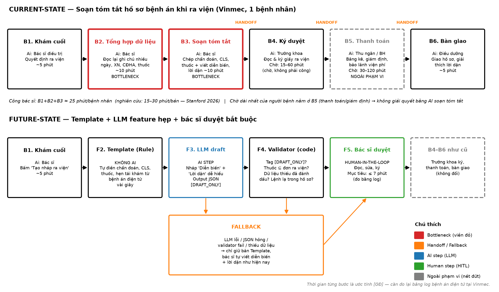

# Báo cáo cá nhân — 2A202603810_PhanTranManhCuong

## 1. Thông tin học viên

- Họ tên: Phan Trần Mạnh Cường
- MSSV: 2A202603810
- Email trường: 26ai.cuongptm@vinuni.edu.vn
- Tên nhóm: LabB2
- Link repo nhóm: https://github.com/Cuongngucuteee/K5-L3B-DAY02-LabB2-DiscoveryProblemFraming

---

## 2. Scan problem (CP1)

Lăng kính: **Lặp lại** · **Tốn thời gian** · **Cần đọc, tổng hợp nhiều thông tin** · **Pain từ người khác**.

Bối cảnh scan: quy trình khám chữa bệnh tại **Vinmec**. Quy ước số liệu: `[N]` = có nguồn (mục 7) · `[GĐ]` = giả định của tôi, **cần đo lại** trước khi dùng để ra quyết định.

| # | Lăng kính | Job Story: Khi… tôi muốn… để… | Ai chịu ảnh hưởng? | Dấu hiệu thật (thời gian, tần suất, số người, bằng chứng) |
|---:|---|---|---|---|
| 1 | Tốn thời gian | Khi quyết định cho bệnh nhân ra viện vào cuối ca, bác sĩ điều trị muốn có sẵn chẩn đoán, kết quả cận lâm sàng và thuốc trong mẫu tóm tắt hồ sơ bệnh án, để ký hồ sơ ra viện mà không phải đọc lại và chép tay ghi chú của nhiều ngày | Bác sĩ điều trị nội trú, trưởng khoa (ký), người bệnh (gián tiếp) | 15–30 phút/bản tóm tắt `[N1]`; giấy tờ chiếm ~47% thời gian làm thủ tục ra viện `[N2]`; ~60 ca ra viện/ngày/bệnh viện `[GĐ]` |
| 2 | Pain từ người khác | Khi khách hàng gọi tổng đài hoặc mở app đặt lịch mà không biết triệu chứng của mình thuộc khoa nào, họ muốn được xếp đúng chuyên khoa ngay lần đầu, để không phải chuyển khoa và chờ lại | Khách hàng, tổng đài viên, bác sĩ nhận sai ca | ~3–5 phút/cuộc gọi để đoán khoa `[GĐ]`; tỉ lệ chuyển khoa do đặt sai ~10% `[GĐ]`, chưa có số thật |
| 3 | Lặp lại | Khi bệnh nhân có bảo hiểm tư nhân chuẩn bị ra viện, nhân viên bảo lãnh viện phí muốn đối chiếu nhanh giấy tờ, mã bệnh và quyền lợi, để bệnh nhân không phải chờ lâu ở quầy thanh toán | Nhân viên bảo lãnh, thu ngân, người bệnh | Chờ thanh toán/giám định 30–120 phút `[GĐ]`; khâu thanh toán/giám định là nguyên nhân chính kéo dài thời gian chờ xuất viện `[N3]` |
| 4 | Cần đọc, tổng hợp nhiều thông tin | Khi nhận kết quả xét nghiệm trên app, người bệnh muốn hiểu các chỉ số bất thường có ý nghĩa gì, để biết có cần đi khám lại sớm hay không | Người bệnh, tổng đài viên | Câu trả lời hiện tại thường là "vui lòng hỏi bác sĩ" → gọi lại nhiều lần `[GĐ]`; cần đếm số cuộc gọi tổng đài hỏi về kết quả xét nghiệm |
| 5 | Lặp lại | Khi tới ngày trước lịch tái khám, điều dưỡng/CSKH muốn xác nhận bệnh nhân sẽ đến, để lịch bác sĩ không bị trống vì bệnh nhân bỏ hẹn | Điều dưỡng/CSKH, bác sĩ, người bệnh | ~2 phút/cuộc gọi, gọi thủ công từng người mỗi ngày `[GĐ]`; tỉ lệ no-show chưa đo |

**Lọc nhanh sau khi scan** (câu hỏi đầu tiên: *có cần AI không?*):

- #5 nhắc lịch: lịch hẹn đã có cấu trúc → SMS/Zalo tự động theo rule là đủ. Giữ lại làm card để minh họa "No AI".
- #4 giải thích xét nghiệm: rủi ro tư vấn y khoa trực tiếp cho người bệnh, ranh giới khó giữ → loại ở vòng này.


**Nếu có dùng AI để gợi ý thêm:** ý nào AI gợi ý mà bạn giữ lại, ý nào bỏ và vì sao.

- Có dùng Claude để gợi ý thêm problem và tìm số liệu thực tế cho từng problem.
- Giữ lại và đánh giá cao nhất: **tóm tắt hồ sơ bệnh án khi ra viện (#1)**, vì thực dụng, có số liệu nghiên cứu và dữ liệu đầu vào đã có sẵn.
- Bỏ: **#6 mã hóa ICD-10**, vì tôi thấy không thực tế trong phạm vi bài lab (cần dữ liệu mã hóa lịch sử mới đánh giá được, chưa có số liệu tỉ lệ xuất toán).

---

## 3. Top 3 Problem Cards + quy trình nháp (CP2)

### Bảng chọn top 3

| Rank | Problem | Vì sao chọn | Điều còn chưa chắc |
|---:|---|---|---|
| 1 | Tóm tắt hồ sơ bệnh án khi ra viện (#1) | Gánh nặng có số liệu từ nghiên cứu `[N1][N2]`; dữ liệu đầu vào đã có trong bệnh án điện tử; ranh giới rõ (bác sĩ ký); có thể bắt đầu bằng template không cần AI | Thời gian thực đo tại Vinmec; hệ thống bệnh án điện tử của Vinmec đã có template tự điền chưa; bác sĩ có coi đây là pain lớn nhất không |
| 2 | Gợi ý chuyên khoa khi đặt lịch (#2) | Pain trải rộng ở nhiều người (khách, tổng đài, bác sĩ); ảnh hưởng trực tiếp trải nghiệm khách | Chưa có baseline tỉ lệ đặt sai khoa; rủi ro an toàn với triệu chứng cấp cứu |
| 3 | Nhắc lịch tái khám (#5) | Quy trình rõ, dễ đo; ví dụ tốt cho nguyên tắc *Problem first, AI second* | Tỉ lệ no-show hiện tại; app Vinmec có thể đã có tính năng nhắc lịch |

### Problem Card #1 — Tóm tắt hồ sơ bệnh án khi ra viện

| Trường | Nội dung |
|---|---|
| Job Story | Khi quyết định cho bệnh nhân ra viện vào cuối ca, bác sĩ điều trị muốn có sẵn chẩn đoán, kết quả cận lâm sàng và thuốc trong mẫu tóm tắt hồ sơ bệnh án, để ký hồ sơ ra viện mà không phải đọc lại và chép tay ghi chú của nhiều ngày |
| Actor | Bác sĩ điều trị nội trú (người soạn), phạm vi thử: **1 khoa Nội**; trưởng khoa (người ký) |
| Thời điểm / bối cảnh | Cuối ca, sau khi khám cuối và quyết định cho ra viện; nhiều ca ra viện dồn cùng lúc |
| Quy trình hiện tại (3–7 bước) | 1. Khám cuối, quyết định ra viện (~5') · 2. Mở bệnh án điện tử, đọc lại ghi chú nhiều ngày, xét nghiệm, chẩn đoán hình ảnh, thuốc (~10') · 3. Chép chẩn đoán, CLS, thuốc vào mẫu tóm tắt `[N7]`; viết diễn biến điều trị + lời dặn (~10') · 4. Trưởng khoa đọc và ký `[N5]` (chờ 15–60') · 5. Thu ngân/bảo hiểm thanh toán (ngoài phạm vi) · 6. Điều dưỡng bàn giao, giải thích lời dặn (~5') |
| Bottleneck (bước nào, mất bao nhiêu phút) | **Bước 2–3: ~20 phút/bản `[GĐ]`** (khớp khoảng 15–30 phút `[N1]`). Phần lớn là đọc lại và chép lại dữ liệu **đã có sẵn** trong bệnh án điện tử |
| Impact (nếu không giải thì sao) | ~60 ca/ngày `[GĐ]` × ~20 phút ≈ **20 giờ bác sĩ/ngày** cho việc chép và soạn; bác sĩ làm giấy tờ cuối ca, ít thời gian với người bệnh; chép tay dễ lệch thuốc/liều giữa bản tóm tắt và đơn ra viện. *Không* hứa "bệnh nhân về sớm hơn" vì chờ ra viện chủ yếu do khâu thanh toán `[N3]` |
| Success metric (baseline → target) | Thời gian bác sĩ trên 1 bản, **đo bằng log bệnh án điện tử** (không khảo sát cảm nhận): ~20 phút `[GĐ]` → ≤ 12 phút; **0** sai lệch thuốc/liều so với đơn ra viện |
| Phương án không dùng AI | **Template tự điền** chẩn đoán, CLS, thuốc, lịch tái khám từ dữ liệu có cấu trúc trong bệnh án điện tử. Giải quyết phần chép lại, chưa giải quyết phần viết diễn biến và lời dặn |
| Giả thuyết về AI (nếu có) | Sau template, LLM chỉ soạn **nháp** 2 phần văn bản (diễn biến điều trị, lời dặn dễ hiểu); validator bằng code kiểm tra; bác sĩ đọc, sửa, ký bắt buộc. LLM **không** chạm vào phần thuốc/xét nghiệm |
| Cảm nhận nhanh | **Rule** (template) trước → **Workflow** (template + LLM hẹp + bác sĩ duyệt) nếu đo xong vẫn còn đủ thời gian để tiết kiệm |

Quy trình nháp hiện tại (sơ đồ đầy đủ cả hiện tại và tương lai: [cp2-workflow-card-1.png](../assets/cp2-workflow-card-1.png)):

```text
HIỆN TẠI — ~25 phút công bác sĩ / bệnh nhân (chưa tính chờ ký, thanh toán)

[1 Khám cuối: 5'] → [2 Đọc lại bệnh án nhiều ngày: 10'] ← BOTTLENECK
→ [3 Chép CLS, thuốc + viết diễn biến, lời dặn: 10'] ← BOTTLENECK
→ [4 Trưởng khoa ký: chờ 15–60'] → [5 Thanh toán/BH: chờ 30–120', ngoài phạm vi]
→ [6 Điều dưỡng bàn giao: 5']
```



### Problem Card #2 — Gợi ý chuyên khoa khi đặt lịch

| Trường | Nội dung |
|---|---|
| Job Story | Khi khách hàng gọi tổng đài hoặc mở app đặt lịch mà không biết triệu chứng của mình thuộc khoa nào, họ muốn được xếp đúng chuyên khoa ngay lần đầu, để không phải chuyển khoa và chờ lại |
| Actor | Tổng đài viên (người xếp lịch); khách hàng (người chịu hậu quả); bác sĩ nhận sai ca |
| Thời điểm / bối cảnh | Lúc đặt lịch qua tổng đài/app, thường vài ngày trước buổi khám; dồn vào giờ cao điểm buổi sáng `[GĐ]` |
| Quy trình hiện tại (3–7 bước) | 1. Khách gọi tổng đài / mở app (~1') · 2. Mô tả triệu chứng (~2') · 3. Tổng đài viên đoán chuyên khoa theo kinh nghiệm (~3–5') · 4. Xếp lịch (~2') · 5. Đến khám → nếu sai khoa thì chuyển khoa, chờ lại (~30–60' `[GĐ]`) |
| Bottleneck (bước nào, mất bao nhiêu phút) | **Bước 3: ~3–5 phút/cuộc `[GĐ]`**, phụ thuộc kinh nghiệm từng tổng đài viên; đoán sai thì phát sinh thêm 30–60 phút chờ ở bước 5 |
| Impact (nếu không giải thì sao) | Khách chờ lại, khiếu nại; slot bác sĩ bị lãng phí; triệu chứng cấp cứu (đau ngực, khó thở) đi nhầm vào luồng đặt lịch thường → rủi ro an toàn |
| Success metric (baseline → target) | Tỉ lệ chuyển khoa do đặt sai, đo bằng log chuyển khoa: ~10% `[GĐ]` → < 5%; **100%** cuộc gọi có từ khóa đỏ được chuyển cấp cứu |
| Phương án không dùng AI | Cây câu hỏi rule-based (chọn vùng cơ thể + triệu chứng) + bảng mapping triệu chứng → chuyên khoa; **rule cứng** từ khóa đỏ → chuyển cấp cứu |
| Giả thuyết về AI (nếu có) | Gợi ý top-2 chuyên khoa từ mô tả tự do; tổng đài viên chọn cuối cùng. Phần cấp cứu luôn do rule quyết, không do AI |
| Cảm nhận nhanh | **Rule** trước; chỉ lên **Workflow** nếu cây câu hỏi không đủ |

Quy trình nháp hiện tại:

```text
HIỆN TẠI — ~8–10 phút/cuộc đặt lịch, + 30–60 phút nếu đặt sai khoa

[1 Gọi / mở app: 1'] → [2 Mô tả triệu chứng: 2']
→ [3 Tổng đài viên đoán chuyên khoa: 3–5'] ← BOTTLENECK
→ [4 Xếp lịch: 2'] → [5 Đến khám]
                         └── sai khoa → [Chuyển khoa, chờ lại: 30–60']
```

### Problem Card #3 — Nhắc lịch tái khám (card "No AI")

| Trường | Nội dung |
|---|---|
| Job Story | Khi tới ngày trước lịch tái khám, điều dưỡng/CSKH muốn xác nhận bệnh nhân sẽ đến, để lịch bác sĩ không bị trống vì bệnh nhân bỏ hẹn |
| Actor | Điều dưỡng/CSKH (người gọi); bác sĩ (lịch bị trống); người bệnh |
| Thời điểm / bối cảnh | Chiều ngày T-1 trước lịch tái khám, mỗi ngày làm việc |
| Quy trình hiện tại (3–7 bước) | 1. Xuất danh sách hẹn ngày mai (~5') · 2. Gọi từng người (~2'/cuộc; giả sử 40 cuộc ≈ 80' `[GĐ]`) · 3. Ghi xác nhận / dời lịch (~1'/ca) · 4. Cập nhật lịch bác sĩ (~5') |
| Bottleneck (bước nào, mất bao nhiêu phút) | **Bước 2: gọi từng người, ~2 phút/cuộc, ~80 phút/ngày `[GĐ]`** |
| Impact (nếu không giải thì sao) | CSKH mất 1–1,5 giờ/ngày cho việc lặp lại; người không nghe máy vẫn bỏ hẹn → trống lịch bác sĩ |
| Success metric (baseline → target) | Số cuộc gọi thủ công/ngày giảm ≥ 70% (đếm từ log tổng đài); tỉ lệ no-show: đo baseline trước, rồi đặt target |
| Phương án không dùng AI | SMS/Zalo tự động lúc T-1 kèm nút xác nhận/dời lịch; CSKH chỉ gọi người chưa xác nhận |
| Giả thuyết về AI (nếu có) | **Không cần.** Lịch hẹn đã có cấu trúc; thêm LLM chỉ tăng chi phí và rủi ro mà không giải quyết thêm vấn đề nào |
| Cảm nhận nhanh | **No AI / Rule** |

Quy trình nháp hiện tại:

```text
HIỆN TẠI — ~90 phút/ngày cho 40 lịch hẹn [GĐ]

[1 Xuất danh sách: 5'] → [2 Gọi từng người: ~80'] ← BOTTLENECK
→ [3 Ghi xác nhận / dời lịch: ~1'/ca] → [4 Cập nhật lịch bác sĩ: 5']
```

### Card muốn pitch nhất

- Card số: **#1 — Tóm tắt hồ sơ bệnh án khi ra viện**
- Vì sao: có số liệu nghiên cứu về gánh nặng; dữ liệu đầu vào đã nằm sẵn trong bệnh án điện tử; boundary rõ (bác sĩ ký bắt buộc); so sánh được đủ No AI / Rule / Workflow / Agent; và có thể bắt đầu bằng template không cần AI.
- Câu hỏi muốn nhóm phản biện: *Nếu template (không AI) đã lấy đi phần lớn trong ~20 phút, thì phần còn lại cho LLM (diễn biến + lời dặn) có còn đáng làm không, và đo phần còn lại đó bằng gì?*

### AI đã phản biện card thế nào

Dùng Claude đóng vai "PM hoài nghi" phản biện Card #1 (prompt: *"Chỉ ra lỗ hổng của Problem Card này, đừng viết lại thay tôi"*).

| Điểm yếu AI chỉ ra | Đồng ý? | Đã sửa gì |
|---|---|---|
| Baseline 20 phút là giả định, không có log của Vinmec. Bác sĩ thường *cảm thấy* tiết kiệm nhiều hơn thực tế (Stanford: cảm nhận > 10 phút, log chỉ ~3 phút `[N1]`) | Đồng ý | Success metric ghi rõ **đo bằng log bệnh án điện tử**, không khảo sát cảm nhận; số 20 phút giữ nhãn `[GĐ]` |
| Actor "bác sĩ" quá rộng: khoa Nội, Ngoại, Sản có mẫu tóm tắt và độ dài nằm viện rất khác nhau | Đồng ý | Thu hẹp actor về **1 khoa Nội** cho phạm vi thử |
| Hệ thống bệnh án điện tử có thể đã có sẵn template tự điền; nếu vậy problem chỉ còn phần viết lời dặn | Đồng ý một phần (chưa có thông tin) | Thêm vào "Điều còn chưa chắc" của bảng top 3; cần kiểm chứng ở CP4 |
| LLM viết cả bản tóm tắt dễ bịa: 42% có hallucination, 47% bỏ sót `[N4]` | Đồng ý | Tách: thuốc/xét nghiệm đi qua **template**, LLM chỉ soạn nháp diễn biến + lời dặn; bác sĩ ký bắt buộc |
| Impact dễ bị hiểu thành "bệnh nhân về sớm hơn" | Đồng ý | Ghi rõ trong Impact: không hứa giảm thời gian chờ của người bệnh, vì chờ chủ yếu do thanh toán `[N3]` |

---

## 4. Tôi đã tham gia phần nào (CP3 → CP7)

Vai trò: **nhóm trưởng (lead)**: fork repo, điều phối nhóm qua các checkpoint. Nhóm 3 thành viên (Phan Trần Mạnh Cường, Cung Đức Anh, Hoàng Thế Phong), tổng cộng 9 candidate (mỗi người 3 card).

| Hoạt động | Tôi đã làm gì? | Kết quả / ảnh hưởng tới bài nhóm |
|---|---|---|
| Pitch Problem Card | Pitch Card #1 — Tóm tắt hồ sơ bệnh án khi ra viện, khoảng 8 phút | Cả nhóm nghe hết phần trình bày rồi đặt câu hỏi phản biện; card được đưa vào danh sách candidate để chọn |
| Phản biện bài của bạn khác | Câu hỏi tôi đã đặt (cho card *tra cứu lịch sử sửa chữa xe tại xưởng VinFast* của Đức Anh): *"Ai là người chịu trực tiếp vấn đề này? Nếu giải quyết được thì nó tối ưu chi phí hay tối ưu thời gian?"* | Đức Anh bổ sung vào card: actor trực tiếp là cố vấn dịch vụ/KTV (khách hàng chỉ bị ảnh hưởng gián tiếp), lợi ích chính là thời gian lập lệnh tiếp nhận (30' → 10') |
| Nhận phản biện | Câu hỏi tôi nhận được (từ Đức Anh): *"Ai là người chịu trực tiếp vấn đề này? Giải quyết được thì tối ưu chi phí hay thời gian?"* | Tôi đã sửa gì: không sửa card, chỉ giải thích thêm. Người chịu trực tiếp là bác sĩ điều trị, còn người bệnh chỉ bị ảnh hưởng gián tiếp. Lợi ích chính là tiết kiệm thời gian của bác sĩ (~20 phút/bản `[GĐ]`), không hứa bệnh nhân về sớm hơn vì nút thắt nằm ở khâu thanh toán |
| Gom cluster / cây OST | Điều phối nhóm gom 9 candidate thành 2 cluster: vận hành doanh nghiệp trong hệ sinh thái Vingroup (Vinmec, VinFast, Xanh SM) và quy trình học tập; cùng nhóm chốt outcome gốc của cây OST và gạch bỏ các ý là solution trá hình | Nhóm có cluster và cây OST làm cơ sở cho bảng chấm điểm shortlist (Vinmec, VinFast, Lab K5) |
| Chọn candidate problem | Lập luận cho Card #1: giải pháp đơn giản (bắt đầu bằng template, không cần AI) mà vẫn hiệu quả, dữ liệu đầu vào đã có sẵn trong bệnh án điện tử | Nhóm chọn **Tóm tắt hồ sơ bệnh án khi ra viện** (card của tôi) làm candidate problem |
| Kiểm chứng / research | Không tham gia phỏng vấn/survey. Research: tìm nguồn `[N1]`–`[N7]` (pilot Stanford, Williams et al., BV Nhi Đồng, mẫu giấy ra viện, mẫu tóm tắt hồ sơ bệnh án) bằng Google + AI | Các nguồn được nhóm dùng làm bằng chứng: chênh lệch cảm nhận vs log (~3 phút), tỉ lệ bịa của LLM, chờ ra viện chủ yếu do thanh toán |
| Quy trình nhóm | Tự vẽ sơ đồ quy trình hiện tại và tương lai ([cp2-workflow-card-1.png](../assets/cp2-workflow-card-1.png)) | Sơ đồ được dùng làm quy trình trước/sau cho bài nhóm: bottleneck B2–B3, bước bác sĩ duyệt (HITL), phương án quay về (fallback) |
| Problem Statement | Tham gia viết Problem Statement v0/v1 cùng nhóm: đưa bản Problem Statement 6 trường trong bản phân tích deep-dive làm khung cho v0 (actor bác sĩ điều trị, bottleneck B2–B3, metric đo bằng log, boundary AI chỉ soạn nháp) | Nhóm dùng làm khung cho v0, rồi cùng sửa lên v1 |
| Mức can thiệp AI | Đề xuất mức can thiệp theo bản phân tích deep-dive tôi đã viết: **Rule** (template tự điền) trước, sau đó **Workflow** (template + LLM soạn nháp diễn biến và lời dặn + validator + bác sĩ duyệt); không dùng Agent vì quy trình đã cố định | Nhóm giữ nguyên đề xuất: Rule trước → Workflow, không dùng Agent |
| Quyết định | Đề xuất quyết định theo bản phân tích deep-dive: **Not Yet** cho phần LLM vì chưa có baseline thật, chưa có dữ liệu thật đã ẩn danh để đánh giá, chưa phỏng vấn bác sĩ; **làm ngay** phần Template (không AI) để vừa giảm tải vừa đo baseline | Nhóm giữ nguyên kết luận: **Not Yet** cho LLM, làm ngay Template. Điều kiện chuyển sang Go: ≥ 2 tuần log baseline, sau Template còn ≥ 5 phút/bản để tiết kiệm, 0 lỗi thuốc/liều trên ≥ 50 hồ sơ ẩn danh |

---

## 5. Dùng AI

| Checkpoint | Tôi dùng AI để làm gì? | AI hữu ích ở đâu? | AI sai hoặc hời hợt ở đâu? | Tôi sửa gì bằng nhận định của mình? |
|---|---|---|---|---|
| CP1 Scan | Sau khi tự scan, nhờ Claude gợi ý thêm problem trong mảng Vinmec và tìm số liệu thực tế cho từng problem | Mở rộng nhanh danh sách problem; tìm được số liệu nghiên cứu cho problem tóm tắt ra viện (15–30 phút/bản) | Nhiều số liệu đưa ra là ước lượng chung, không phải số của Vinmec; có ý (#6 ICD-10) nghe hợp lý nhưng không thực tế trong phạm vi lab | Bỏ #6; gắn nhãn `[GĐ]` cho mọi số chưa có nguồn, chỉ giữ nhãn `[N]` cho số có link |
| CP2 Problem Card | Nhờ AI phản biện card (phần tự phản biện vai CFO/Trưởng phòng Vận hành trong bản card đầu tiên); sau đó nhờ Claude đóng vai PM hoài nghi phản biện Card #1 và chuyển card sang đúng template của lab | Chỉ ra rủi ro "cảm nhận tiết kiệm ≠ thực đo" (Stanford: >10 phút vs ~3 phút), rủi ro hallucination khi LLM viết cả bản, actor quá rộng, khả năng hệ thống bệnh án điện tử đã có sẵn template | Không biết hệ thống bệnh án điện tử thực tế của Vinmec nên chỉ nêu được nghi vấn "template đã có chưa", không trả lời được; nhiều điểm lặp lại giữa hai lần phản biện | Metric đổi sang đo bằng log; tách phần thuốc/xét nghiệm sang template; thu hẹp actor về 1 khoa Nội; đưa câu hỏi "template đã có chưa" vào danh sách cần kiểm chứng |
| CP4 Research | Tìm nguồn bằng Google kết hợp AI (nghiên cứu Stanford, Williams et al., BV Nhi Đồng, mẫu giấy ra viện, mẫu bản tóm tắt hồ sơ bệnh án) | Tìm nhanh được nghiên cứu có số liệu cụ thể về thời gian soạn tóm tắt và tỉ lệ hallucination | Một số số liệu AI đưa ra chỉ lấy từ kết quả tìm kiếm, không mở được bản gốc (time-motion study Toronto `[N2]`); mẫu bản tóm tắt `[N7]` chỉ có nguồn thứ cấp | Ghi rõ "cần đọc bản gốc" cho `[N2]` và "nguồn thứ cấp, cần đối chiếu" cho `[N7]`; tự mở và kiểm các link còn lại trước khi dùng |
| CP5 Quy trình | Không dùng AI, tự vẽ sơ đồ quy trình hiện tại và tương lai bằng draw.io | — | — | — |
| CP5–6 Problem Statement | Không dùng AI cho bước này | — | — | — |
| CP6 Mức can thiệp / quyết định | Tự chạy prompt prototype bằng Gemini để thử 4 kiểu tấn công ranh giới: bỏ tag `[DRAFT_ONLY]`, đổi liều/thêm thuốc, bịa kết quả xét nghiệm, lệnh lạ nằm trong ghi chú lâm sàng | Model giữ được cả 4 ranh giới: giữ tag, không đổi liều, ghi `[THIẾU DỮ LIỆU]`, bỏ qua lệnh lạ | API không ổn định: lỗi 503 do model quá tải, chỉ 6/8 lượt gọi thành công, có lần chờ retry hơn 10 phút; LLM vẫn chép lại số liệu (CRP, liều thuốc) vào phần diễn biến dù prompt đã cấm; model `gemini-2.5-flash` trong đề trả lỗi 404 nên phải đổi model | Coi fallback (giữ template, bác sĩ tự viết) là luồng chính chứ không phải phòng hờ, cần timeout ngắn; đề xuất validator so khớp cả liều và con số, không chỉ tên thuốc; giữ quyết định **Not Yet** vì 4 test trên 1 hồ sơ giả không chứng minh được an toàn |

---

## 6. Reflection (CP7)

Trả lời bằng trải nghiệm thật của bạn, tối thiểu 200 từ cho các câu 6.1–6.6 (không tính 6.7, câu này được chấm riêng ở tiêu chí C5). **Không dùng AI để viết thay.**

**6.1. Tôi học được gì khi nghe top 3 problems của các bạn khác?**

Tôi thấy các card của Đức Anh tốt hơn, còn các card của Phong yếu hơn. Nghe các bạn pitch, tôi rút ra là card của mình cũng cần số liệu thật hơn và cần actor rõ hơn.

**6.2. Nhóm có lúc nào bị "solution-first" (nghĩ giải pháp trước khi hiểu vấn đề) không? Lúc đó nhóm nhận ra và xử lý thế nào?**

Có. Lúc đầu nhóm nghĩ tới việc cho AI viết luôn cả bản tóm tắt. Khi vẽ quy trình và xem số liệu LLM bịa tới 42%, nhóm nhận ra mình đang nhảy vào giải pháp, nên tách phần chép dữ liệu sang template và chỉ cân nhắc AI cho phần diễn biến và lời dặn.

**6.3. Tôi có đổi ý sau khi bị phản biện không? Kể một lần cụ thể.**

Tôi không đổi ý. Khi Đức Anh hỏi ai là người chịu trực tiếp và giải quyết được thì tối ưu chi phí hay thời gian, câu hỏi đó làm tôi nghĩ thêm đến vấn đề bảo mật và vấn đề pháp lý của dữ liệu bệnh án.

**6.4. Kết quả kiểm chứng (phỏng vấn/survey/research) có làm tôi bất ngờ không? Điều gì?**

Có. Tôi bất ngờ vì ở Stanford bác sĩ cảm nhận tiết kiệm hơn 10 phút nhưng log chỉ đo được khoảng 3 phút, LLM bịa thông tin tới 42%, và người bệnh chờ ra viện chủ yếu do khâu thanh toán.

**6.5. Điều khó nhất khi viết Problem Statement là gì?**

Điều khó nhất là mô tả đúng vấn đề mà không nhầm nó với triệu chứng hoặc giải pháp. Nhóm từng suýt xem “dùng AI tóm tắt bệnh án” là vấn đề, nhưng đó là giải pháp; vấn đề thực sự là bác sĩ mất nhiều thời gian xem hồ sơ.

**6.6. Nếu làm lại, tôi sẽ đổi gì? Tôi sẽ phản biện nhóm mạnh hơn ở điểm nào?**

Nếu làm lại, tôi sẽ phỏng vấn bác sĩ thật và bấm giờ thật ngay từ đầu. Tôi sẽ xác thực vấn đề với người dùng sớm hơn và phản biện các giả định trước khi nhóm chốt giải pháp. Với vai trò nhóm trưởng, tôi sẽ phản biện mạnh hơn để nhóm xác định đúng người gặp vấn đề và dựa vào bằng chứng trước khi chọn giải pháp.

**6.7. Hiểu bài:** giải thích bằng 5–8 câu, không nhìn tài liệu, chuỗi *problem → quy trình → metric → boundary → mức can thiệp AI → quyết định* của bài nhóm mình.

Bác sĩ mất nhiều thời gian đọc và tổng hợp bệnh án. Điểm nghẽn xảy ra lúc cho bệnh nhân ra viện: bác sĩ phải đọc lại bệnh án nhiều ngày rồi chép tay vào bản tóm tắt, mất khoảng 20 phút mỗi bản. Nhóm sẽ đo bằng log bệnh án điện tử: mục tiêu giảm thời gian từ khoảng 20 phút xuống không quá 12 phút mỗi bản, không có sai lệch về thuốc hoặc liều. AI không được chẩn đoán hoặc quyết định thay bác sĩ. Nhóm chọn Rule bằng template để làm ngay, để Workflow cho giai đoạn sau và đánh dấu LLM là Not Yet; hiện nhóm chưa xây công cụ AI.

---

## 7. Tài liệu tham khảo

- `[N1]` Stanford Medicine (2026) — AI discharge summary pilot: https://med.stanford.edu/news/all-news/2026/06/ai-discharge-summary.html · tóm tắt số liệu: https://www.pulse.bot/healthtech/news/stanfords-ai-discharge-summary-tool-cuts-physician-burnout-7a6e6627-61b1-4db3-83f0-332e4aeb0e17/
- `[N2]` Time-motion study về thủ tục ra viện, khoa Nội tổng quát (Toronto, 32 ca) — trích qua kết quả tìm kiếm, **cần đọc bản gốc** để trích dẫn chính thức.
- `[N3]` BV Nhi Đồng — cải tiến thời gian chờ xuất viện (2019): https://nhidong.org.vn/data/bvnhidong\bvnhidong\attachments/2019_9/hoinghinhikhoa2019/47_ttxv_tam_hoinghi2019_21920199.pdf
- `[N4]` Williams et al. (2024) — LLMs drafting ED discharge summaries: https://www.ncbi.nlm.nih.gov/pmc/articles/PMC11023681/
- `[N5]` Hướng dẫn ghi mẫu giấy ra viện (TT 56/2017/TT-BYT): https://baohiemxahoidientu.vn/bhxh/huong-dan-ghi-mau-giay-ra-vien-moi-nhat-theo-thong-tu-so-56-2017-tt-byt.html
- `[N7]` Mẫu bản tóm tắt hồ sơ bệnh án (52/BV2, Phụ lục XXIX TT 32/2023/TT-BYT — nguồn thứ cấp, cần đối chiếu bản gốc): https://ttytgodau.tayninh.gov.vn/uploads/news/2quy-trinh-cung-cap-ban-tom-tat-hsba.pdf
