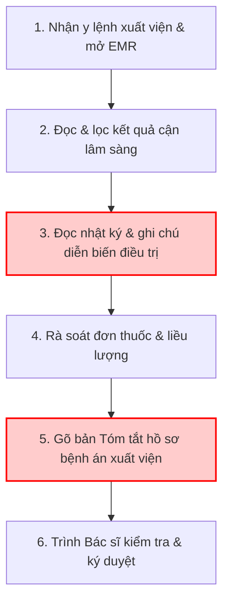
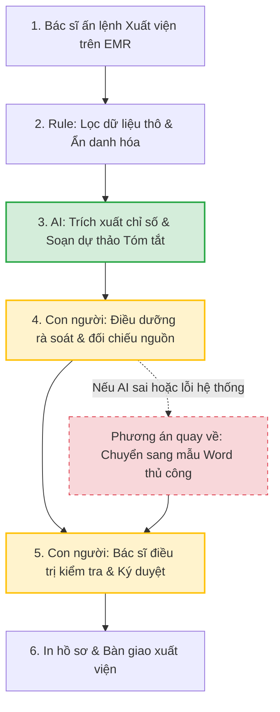

# Báo cáo nhóm — Day 02 Discovery & Problem Framing

> Bản chung của nhóm, viết trên repo do nhóm trưởng fork. Không copy file này sang repo cá nhân.
> Template chi tiết và prompt mẫu: [docs/01-worksheet.md](../../docs/01-worksheet.md). Bài mẫu: [docs/02-deliverable-example.md](../../docs/02-deliverable-example.md).

## 1. Thông tin nhóm

- Tên nhóm: LabB2
- Thành viên: xem `TEAM.md`
- Candidate problem được chọn (1 câu): Tóm tắt hồ sơ bệnh án khi ra viện tại khoa Nội - Bệnh viện Đa khoa Quốc tế Vinmec (giảm tải gánh nặng đọc lại và chép tay cho bác sĩ điều trị)
- Quyết định cuối: **Not Yet** cho phần LLM (làm ngay phần Template tự điền không dùng AI để vừa giảm tải vừa đo baseline)

---

## 2. Hội tụ nhóm (CP3)

### 2.1. Pitch

| # | Người đưa ra | Candidate (Job Story ngắn) | Actor | Bottleneck | Câu hỏi phản biện nhận được (ai hỏi) |
|---:|---|---|---|---|---|
| 1 | Phan Trần Mạnh Cường | Khi quyết định cho bệnh nhân ra viện vào cuối ca, bác sĩ điều trị muốn có sẵn chẩn đoán, kết quả cận lâm sàng và thuốc trong mẫu tóm tắt hồ sơ bệnh án, để ký hồ sơ mà không phải đọc lại và chép tay ghi chú nhiều ngày | Bác sĩ điều trị nội trú khoa Nội tại Vinmec | Đọc lại bệnh án nhiều ngày và chép tay các dữ liệu đã có sẵn trong bệnh án điện tử (~20 phút `[GĐ]`) | Ai là người chịu trực tiếp vấn đề này? Giải quyết được thì tối ưu chi phí hay thời gian? (Đức Anh hỏi) |
| 2 | Cung Đức Anh | Khi tiếp nhận xe vào xưởng bảo dưỡng hoặc sửa chữa, cố vấn dịch vụ/KTV muốn tra cứu nhanh toàn bộ lịch sử sửa chữa và mã phụ tùng cũ từ DMS, để lập lệnh tiếp nhận chính xác trong vòng 10 phút | Cố vấn dịch vụ và KTV tại xưởng VinFast | Tra cứu phân mảnh giữa phần mềm quản lý xưởng DMS và tài liệu kỹ thuật tra mã phụ tùng (15–20 phút) | Ai là người chịu trực tiếp vấn đề này? Nếu giải quyết được thì nó tối ưu chi phí hay tối ưu thời gian? (Cường hỏi) |
| 3 | Cung Đức Anh | Khi bắt đầu buổi lab với 6–8 file tài liệu phân mảnh, tôi muốn nhanh chóng nắm được sơ đồ nhiệm vụ và file cần điền, để bắt tay làm bài ngay mà không mất 60–90' định hình đề | Học viên khóa học AI K5 | Nhảy qua lại giữa CHECKPOINTS, RUBRIC và Worksheet để chắp vá yêu cầu (50–60 phút) | Nếu cấu trúc file mỗi ngày một khác thì công cụ tóm tắt có bị sót bẫy trừ điểm trong rubric không? (Cường hỏi) |
| 4 | Phan Trần Mạnh Cường | Khi khách hàng gọi tổng đài hoặc mở app đặt lịch mà không biết triệu chứng thuộc khoa nào, họ muốn được xếp đúng chuyên khoa ngay lần đầu, để không phải chuyển khoa và chờ lại | Tổng đài viên và khách hàng Vinmec | Tổng đài viên đoán chuyên khoa theo kinh nghiệm cá nhân, dễ sai lệch (3–5 phút/cuộc) | Triệu chứng cấp cứu đi nhầm vào luồng đặt lịch thường thì xử lý rủi ro an toàn thế nào? (Đức Anh hỏi) |
| 5 | Phan Trần Mạnh Cường | Khi tới ngày trước lịch tái khám, điều dưỡng/CSKH muốn xác nhận bệnh nhân sẽ đến, để lịch bác sĩ không bị trống vì bệnh nhân bỏ hẹn | Điều dưỡng/CSKH gọi điện thủ công | Gọi điện thoại thủ công từng người mỗi ngày (~80 phút/ngày cho 40 cuộc gọi) | Lịch hẹn đã có cấu trúc, dùng SMS/Zalo rule tự động là xong, có cần đến AI không? (Đức Anh hỏi) |
| 6 | Trần Thị Bình | Khi nhận hàng chục phản ánh của cư dân mỗi ngày, tôi muốn phân loại chính xác mức độ khẩn cấp và chuyển tiếp đúng bộ phận kỹ thuật/an ninh xử lý, để cư dân được phản hồi trong 15 phút | Nhân viên BQL tòa nhà Vinhomes | Đọc và lọc thủ công 40–60 ticket mỗi ngày (30–60 phút) | Cư dân dùng từ lóng hoặc đính kèm ảnh thì mô hình phân loại có chính xác không? (Cường hỏi) |

### 2.2. Cluster

| Cluster | Các candidate | Pattern chung |
|---|---|---|
| A | Candidate #1 (Vinmec xuất viện), #3 (VinFast sửa xe), #5 (Vinhomes xử lý ticket) | Tối ưu hóa các quy trình vận hành và hành chính doanh nghiệp quy mô lớn trong hệ sinh thái Vingroup bằng cách tổng hợp dữ liệu phân mảnh |
| B | Candidate #2 (Đọc đề lab phân mảnh), #4 (Quy cách nộp bài), #6 (So sánh thí nghiệm mô hình) | Tối ưu hóa quy trình học tập, thực hành kỹ thuật và làm bài lab của sinh viên/học viên AI |

### 2.3. Opportunity Solution Tree rút gọn

Gốc là **1 outcome**. Nhánh là **opportunity** (nhu cầu, pain), không phải tính năng hay công cụ.

```text
OUTCOME: Giảm thời gian xử lý thủ tục hành chính lặp lại cho nhân sự vận hành
├── Opportunity A: Điều dưỡng mất nhiều thời gian gom kết quả cận lâm sàng và ghi chú điều trị khi bệnh nhân xuất viện
├── Opportunity B: Cố vấn dịch vụ tốn thời gian đối chiếu lịch sử sửa chữa xe giữa các phần mềm riêng biệt
└── Opportunity C: Sinh viên bị quá tải vì phải đọc và chắp vá thông tin từ 6–8 file tài liệu đề bài phân mảnh
```

Những ý đã gạch bỏ vì là solution đội lốt opportunity:

- ✗ *"Xây dựng Chatbot AI y tế tự động chẩn đoán bệnh cho bệnh nhân"* (Solution trá hình, vi phạm nghiêm trọng an toàn y tế và luật khám chữa bệnh).
- ✗ *"Hệ thống AI tự động phê duyệt đơn thuốc và cho bệnh nhân xuất viện"* (Solution trá hình, tước đoạt vai trò pháp lý của bác sĩ).
- ✗ *"Phần mềm tự động tạo pull request sửa code sinh viên"* (Solution trá hình, làm giảm hiệu quả tự học).

### 2.4. Chấm điểm shortlist (1–5)

| Candidate | Actor rõ | Quy trình rõ | Pain có bằng chứng | Impact đo được | Vừa sức lab | So sánh được No AI/Rule/Workflow/Agent | Nhóm hiểu domain | Tổng |
|---|---:|---:|---:|---:|---:|---:|---:|---:|
| **#1 Vinmec (Tóm tắt bệnh án xuất viện)** | 5 | 5 | 5 | 5 | 4 | 5 | 4 | **33** |
| **#2 Lab K5 (Định vị đề bài phân mảnh)** | 5 | 5 | 5 | 4 | 5 | 4 | 4 | **32** |
| **#3 VinFast (Lịch sử bảo dưỡng xe)** | 4 | 4 | 4 | 4 | 4 | 4 | 4 | **28** |

**Candidate được chọn:** **Candidate #1 — Hỗ trợ điều dưỡng tổng hợp tóm tắt hồ sơ bệnh án xuất viện tại Vinmec.**

**Vì sao chọn:**
1. **Value & Impact xã hội vượt trội:** Giải phóng trực tiếp từ 1.5 đến 3 tiếng mỗi ca trực cho điều dưỡng khỏi việc gõ giấy tờ hành chính, giúp họ tập trung chăm sóc bệnh nhân và rút ngắn thời gian chờ xuất viện.
2. **Quy trình và điểm nghẽn đo lường được:** Quy trình xuất viện nội trú gồm 6 bước rõ ràng, điểm nghẽn đọc gom dữ liệu EMR chiếm 70% thời gian (15–18 phút/bệnh nhân).
3. **Bài học Problem Framing chuẩn mực:** Đặt ra bài toán thực tế về Ranh giới (Boundary), rủi ro sai sót y khoa (Safety) và bảo mật dữ liệu nhạy cảm (Privacy), buộc nhóm phải cân nhắc cẩn trọng giữa các mức Rule, Workflow và Agent thay vì chạy theo công nghệ mù quáng.

**Vì sao loại các candidate còn lại:**
- *Loại Candidate #3 (VinFast):* Dữ liệu xưởng và mã lỗi phụ tùng tại các đại lý phụ thuộc nhiều vào nhà cung cấp phần mềm DMS bên ngoài, nhóm khó tiếp cận quy trình chuẩn trong thời gian ngắn.
- *Loại Candidate #2 (Lab K5):* Mặc dù rất gần gũi với nhóm, nhưng giải pháp có xu hướng giải quyết được bằng Rule/Cheat-sheet đơn giản, giá trị ứng dụng và độ phức tạp về mặt nghiệp vụ không phong phú bằng bài toán y tế của Vinmec.

**Xử lý bất đồng (nếu có):**
Ban đầu có sự lo ngại về tính khả thi (Feasibility) do dữ liệu bệnh án y tế là dữ liệu tuyệt mật không thể đưa lên API AI công cộng. Nhóm đã thống nhất xử lý bằng cách: Giới hạn giải pháp ở mức **Workflow hỗ trợ soạn thảo văn bản dự thảo (Documentation Assistant)** chạy trên hạ tầng On-premise/Private Cloud và áp dụng module ẩn danh hóa (De-identification) để tuân thủ tuyệt đối quy định pháp lý.

---

## 3. Kiểm chứng + research giải pháp đã có (CP4)

### 3.1. Assumption Map

| # | Giả định | Loại (Value / Usability / Feasibility / Viability) | Quan trọng (1–5) | Đã có bằng chứng (1–5) | Kiểm chứng trước? |
|---:|---|---|---:|---:|---|
| 1 | Điều dưỡng và bệnh viện thực sự coi việc gõ tóm tắt bệnh án xuất viện là điểm nghẽn làm chậm giờ ra viện | Value | 5 | 4 | Có |
| 2 | Bác sĩ điều trị sẵn sàng đọc và duyệt bản nháp do AI tổng hợp nếu các số liệu có trích dẫn nguồn đối chiếu | Usability | 5 | 2 | Có |
| 3 | Mô hình NLP có thể trích xuất chính xác kết quả xét nghiệm và diễn biến từ văn bản tiếng Việt của bác sĩ | Feasibility | 4 | 3 | Không |
| 4 | Bệnh viện cho phép triển khai giải pháp AI xử lý dữ liệu bệnh án nội bộ trên hạ tầng On-premise | Viability | 5 | 2 | Có |
| 5 | Giải pháp không dùng AI (template Word + macro tự điền trường định danh) không đủ để giải quyết phần tóm tắt diễn biến | Value | 4 | 4 | Không |

Giả định nhóm kiểm chứng trong buổi này: **Giả định #1 (Nỗi đau thực tế của nhân viên y tế), Giả định #2 (Sự chấp nhận và ranh giới trách nhiệm của Bác sĩ), và Giả định #4 (Rào cản pháp lý bảo mật bệnh án).**

### 3.2. Kiểm chứng

Cách đã dùng: **Phỏng vấn sâu theo 3 nguyên tắc The Mom Test** (hỏi về trải nghiệm và hành vi thực tế đã diễn ra, không hỏi ý kiến giả định).

Interview snapshot #1:

| Trường | Nội dung |
|---|---|
| Người được hỏi (vai trò, không ghi tên thật) | Điều dưỡng hành chính khoa Nội tổng hợp (kinh nghiệm 4 năm tại bệnh viện tư nhân tiêu chuẩn quốc tế) |
| Câu nói đáng nhớ nhất (nguyên văn) | *"Cứ đến 9h30 sáng là phòng điều dưỡng như chiến trường. Bệnh nhân đứng xếp hàng chờ giấy ra viện để thanh toán bảo hiểm, trong khi tôi phải mở cùng lúc 4 cửa sổ phần mềm để chép từng chỉ số máu và đơn thuốc vào file Word."* |
| Lần gần nhất gặp vấn đề này: chuyện gì đã xảy ra? | Sáng thứ Sáu tuần trước, có 8 bệnh nhân xuất viện cùng lúc. Chị phải mất gần 2.5 tiếng liên tục chỉ để ngồi gõ hồ sơ tóm tắt, khiến 2 bệnh nhân bị muộn chuyến xe về quê và người nhà phàn nàn gay gắt tại quầy lễ tân. |
| Hiện đang xử lý bằng cách nào (workaround)? | Dùng một file Word mẫu có sẵn khung, mở từng tab xét nghiệm trên hệ thống EMR rồi dùng chuột bôi đen copy-paste từng dòng chỉ số vào file. |
| Mất bao lâu, bao lần? | Trung bình 15–20 phút/hồ sơ bệnh nhân thường, 30 phút đối với bệnh nhân phẫu thuật có diễn biến phức tạp; diễn ra hàng ngày vào các buổi sáng. |
| Insight / opportunity rút ra | Nhu cầu lớn nhất không phải là AI viết văn hoa mỹ, mà là tự động gom chính xác các con số xét nghiệm bất thường và danh mục thuốc ra viện vào đúng biểu mẫu để không phải copy tay. |

Interview snapshot #2:

| Trường | Nội dung |
|---|---|
| Người được hỏi (vai trò, không ghi tên thật) | Bác sĩ điều trị khoa Ngoại (kinh nghiệm 7 năm công tác tại bệnh viện đa khoa) |
| Câu nói đáng nhớ nhất (nguyên văn) | *"Tôi không bao giờ ký một bản tóm tắt bệnh án nếu không biết con số đó lấy từ kết quả xét nghiệm ngày nào. Sai một dấu phẩy liều thuốc là nguy hiểm đến tính mạng người bệnh."* |
| Lần gần nhất gặp vấn đề này: chuyện gì đã xảy ra? | Tháng trước, một điều dưỡng trong lúc gõ vội đã copy nhầm liều thuốc huyết áp từ hồ sơ bệnh nhân giường bên cạnh, may mắn bác sĩ đọc lại phát hiện kịp trước khi ký xuất viện. |
| Hiện đang xử lý bằng cách nào (workaround)? | Bác sĩ bắt buộc phải mở lại bệnh án điện tử để dò chéo từng chỉ số quan trọng trước khi đặt bút ký số. |
| Mất bao lâu, bao lần? | Mất 5–7 phút duyệt mỗi hồ sơ; mỗi sáng duyệt 5–10 hồ sơ. |
| Insight / opportunity rút ra | Ranh giới trách nhiệm y khoa là tối thượng. Bác sĩ yêu cầu mọi thông tin AI trích xuất phải có link đối chiếu trực tiếp về hồ sơ gốc (grounding citation) để họ xác thực trong 30 giây. |

Tổng hợp:

| Nguồn | Số người / số mẫu | Tín hiệu xác nhận | Tín hiệu phản bác |
|---|---:|---|---|
| Phỏng vấn điều dưỡng & bác sĩ | 2 người (1 điều dưỡng, 1 bác sĩ) | 100% xác nhận thủ tục xuất viện gây tắc nghẽn nghiêm trọng buổi sáng; việc copy-paste số liệu thủ công rất dễ gây lỗi sai sót | Bác sĩ phản bác gay gắt việc để AI tự động kết luận hay ban hành hồ sơ mà không có người duyệt; không chấp nhận giải pháp đưa dữ liệu bệnh án ra internet |

**Nhóm đã sửa problem thế nào sau kiểm chứng:**
1. Thu hẹp phạm vi: Không để AI tự sinh phần nhận xét chẩn đoán bệnh mới, mà tập trung 100% vào việc **trích xuất và tóm tắt có đối chiếu nguồn (grounded summarization)** từ dữ liệu xét nghiệm và y lệnh đã có của bác sĩ.
2. Bổ sung tính năng cốt lõi: Mỗi dòng thông tin AI đưa vào bản tóm tắt phải có cơ chế highlight đối chiếu về đúng tab và thời điểm xét nghiệm tương ứng trong EMR.

### 3.3. Research giải pháp đã có

| Công cụ / case / pattern | Link | Giải bước nào trong quy trình? | Điểm mạnh | Khoảng trống / rủi ro | Bài học cho nhóm |
|---|---|---|---|---|---|
| **Nuance Dragon Copilot (Microsoft DAX)** | [nuance.com/healthcare/ambient-clinical-intelligence](https://www.nuance.com/healthcare/ambient-clinical-intelligence.html) | Ghi nhận cuộc hội thoại bác sĩ - bệnh nhân và tự động soạn thảo ghi chú lâm sàng | Tích hợp sâu vào hệ thống EHR quốc tế (Epic, Cerner); xử lý ngôn ngữ y khoa tiếng Anh rất chuẩn | Chi phí bản quyền cực kỳ đắt đỏ; chưa hỗ trợ tiếng Việt chuyên ngành y khoa; tập trung vào khám ngoại trú hơn là thủ tục xuất viện nội trú | Cần thiết kế giao diện đơn giản tập trung vào biểu mẫu xuất viện chuẩn của Việt Nam |
| **GatorTron / BioGPT (Clinical LLM Open Source)** | [github.com/UF-HOBI-Yosef-Lab/GatorTron](https://github.com/UF-HOBI-Yosef-Lab/GatorTron) | Trích xuất thực thể y tế (NER) và tóm tắt hồ sơ bệnh án tự do | Mô hình mã nguồn mở có thể tự host On-premise, đảm bảo 100% bảo mật dữ liệu y tế (HIPAA/PHI) | Cần tinh chỉnh (fine-tuning) thêm với tập dữ liệu thuật ngữ y tế tiếng Việt; nguy cơ ảo giác nếu prompt không có grounding | Bắt buộc phải triển khai mô hình nội bộ On-premise và dùng kỹ thuật RAG có trích dẫn nguồn số liệu |
| **Epic Systems Discharge Summarization Module** | [epic.com/features](https://www.epic.com) | Tự động điền dữ liệu xét nghiệm vào bản tóm tắt xuất viện | Độ ổn định cao, tuân thủ nghiêm ngặt chuẩn quốc tế | Phụ thuộc hoàn toàn vào hệ sinh thái phần mềm đóng Epic; bệnh viện không dùng Epic không thể áp dụng | Nên xây dựng dưới dạng module tích hợp qua chuẩn giao tiếp y tế HL7 FHIR để dễ kết nối với hệ thống EMR sẵn có |

---

## 4. Quy trình trước/sau (CP5)

### 4.1. Quy trình hiện tại

Sơ đồ Mermaid quy trình hiện tại:



| Bước | Actor | Input | Output | Thời gian / tần suất | Ghi chú |
|---:|---|---|---|---|---|
| 1 | Điều dưỡng | Y lệnh xuất viện của bác sĩ | Hồ sơ bệnh án điện tử được mở | 2 phút / lượt | Mở hệ thống EMR |
| 2 | Điều dưỡng | Kết quả xét nghiệm máu, X-quang, CT trên EMR | Danh sách chỉ số bất thường đã chọn lọc | 5 phút / lượt | Phải click qua 3–4 tab xét nghiệm |
| 3 | Điều dưỡng | Nhật ký theo dõi hàng ngày của các bác sĩ | Đoạn văn tóm tắt diễn biến điều trị | 6 phút / lượt | **BOTTLENECK:** Đọc nhiều trang ghi chú viết tự do |
| 4 | Điều dưỡng | Lịch sử dùng thuốc nội trú & đơn thuốc về | Danh mục thuốc và liều dùng | 3 phút / lượt | Đối chiếu chống chỉ định |
| 5 | Điều dưỡng | Các thông tin đã gom ở bước 2, 3, 4 | File Word Tóm tắt bệnh án hoàn chỉnh | 6 phút / lượt | **BOTTLENECK:** Gõ tay thủ công vào mẫu biểu |
| 6 | Bác sĩ | Bản tóm tắt in ra hoặc trên màn hình | Bản tóm tắt có chữ ký số/ký tay | 3 phút / lượt | Bác sĩ kiểm tra lại tính chính xác |

**Bottleneck chính:** Bước 3 (Lược diễn biến điều trị) và Bước 5 (Gõ bản tóm tắt biểu mẫu) tiêu tốn từ 12–15 phút, gây quá tải cho điều dưỡng vào giờ cao điểm.

### 4.2. Quy trình tương lai

Quy trình tương lai phân định rõ: **Rule** (trích xuất thông tin hành chính, ẩn danh hóa), **AI** (soạn thảo dự thảo tóm tắt và đối chiếu nguồn), **Con người** (Điều dưỡng rà soát và Bác sĩ ký duyệt — HITL), **Boundary** (AI không chẩn đoán mới, không tự ban hành) và **Phương án quay về**.



- **Bước 1 (Hệ thống):** Tiếp nhận tín hiệu bệnh nhân được chỉ định xuất viện.
- **Bước 2 (Rule-based):** Tự động gom dữ liệu định danh bệnh nhân, kết quả cận lâm sàng và lịch sử dùng thuốc từ EMR; module De-identification xóa bỏ thông tin nhạy cảm trước khi xử lý.
- **Bước 3 (AI Workflow):** Mô hình ngôn ngữ chuyên sâu y khoa tóm tắt diễn biến điều trị và trích xuất các chỉ số bất thường có kèm deep-link đối chiếu ngược về hồ sơ gốc.
- **Bước 4 (Con người - HITL):** Điều dưỡng mở bản dự thảo, bấm vào các link đối chiếu để kiểm tra nhanh trong 2–3 phút, chỉnh sửa nếu cần.
- **Bước 5 (Con người - HITL):** Bác sĩ điều trị xem lại các điểm cốt lõi và thực hiện ký số xác nhận tính pháp lý.
- **Phương án quay về (Fallback):** Nếu hệ thống AI gặp sự cố (timeout > 30s) hoặc tỷ lệ chỉnh sửa của điều dưỡng > 50%, hệ thống tự động xuất dữ liệu thô sang mẫu template Word truyền thống để điều dưỡng xử lý thủ công, không làm gián đoạn giờ ra viện của bệnh nhân.

### 4.3. Before / after

| Chỉ số | Trước | Sau (kỳ vọng) | Ghi chú |
|---|---:|---:|---|
| Số bước quy trình | 6 bước | 6 bước | Bổ sung các chốt chặn kiểm soát chất lượng |
| Tổng thời gian xử lý | 25 phút / hồ sơ | 7 phút / hồ sơ | Giảm ~72% thời gian hành chính |
| Thời gian gõ và tổng hợp (Bottleneck) | 12–15 phút | < 2 phút | Do AI soạn sẵn dự thảo kèm nguồn đối chiếu |
| Số bước thủ công của điều dưỡng | 5 bước | 1 bước (rà soát đối chiếu) | Giải phóng sức lao động |
| Rủi ro mới phát sinh | Sai sót do mệt mỏi khi copy-paste thủ công | Ảo giác của mô hình AI về số liệu hoặc liều thuốc | Xử lý bằng cơ chế Grounding Citation bắt buộc và Bác sĩ ký duyệt |

---

## 5. Problem Statement v0 (CP5)

| Trường | Nội dung |
|---|---|
| **Actor** | Điều dưỡng khoa lâm sàng tại Bệnh viện Đa khoa Quốc tế Vinmec phụ trách thủ tục xuất viện cho bệnh nhân nội trú |
| **Quy trình** | Quy trình lập Tóm tắt hồ sơ bệnh án xuất viện: Mở EMR → Đọc kết quả cận lâm sàng → Lược diễn biến điều trị → Rà soát thuốc → Gõ bản tóm tắt → Trình Bác sĩ ký duyệt |
| **Bottleneck** | Bước đọc gom dữ liệu từ nhiều tab chuyên khoa và gõ văn bản tóm tắt diễn biến bệnh, tiêu tốn 15–18 phút cho mỗi hồ sơ |
| **Impact** | Điều dưỡng mất 1.5–3 tiếng mỗi ca trực buổi sáng chỉ để làm thủ tục giấy tờ; bệnh nhân chờ lâu gây bức xúc; tắc nghẽn giường bệnh nội trú; nguy cơ sai sót sao chép số liệu y khoa |
| **Success Metric** (baseline → target, cách đo) | Thời gian hoàn thiện bản tóm tắt giảm từ 25 phút xuống dưới 7 phút/hồ sơ; tỷ lệ thông tin lâm sàng cốt lõi được trích xuất chính xác $\ge 95\%$; 100% hồ sơ được Bác sĩ kiểm tra và ký xác nhận |
| **Boundary** (AI không được làm gì; khi nào cần con người kiểm tra — HITL) | AI tuyệt đối KHÔNG tự ý chẩn đoán bệnh mới, KHÔNG tự ý thay đổi y lệnh thuốc, và KHÔNG được tự động ban hành hồ sơ mà không có chữ ký số của Bác sĩ điều trị. Điều dưỡng và Bác sĩ bắt buộc phải kiểm tra đối chiếu (HITL) |

Phản biện nhận được (từ AI hoặc nhóm khác) và nhóm có đồng ý không:

- *Phản biện 1:* Metric 95% độ chính xác trích xuất là đo trên những trường thông tin nào? $\to$ **Đồng ý:** Nhóm cụ thể hóa: 95% tính trên 4 trường cốt lõi bắt buộc: Chẩn đoán ra viện, Can thiệp/Phẫu thuật chính, Kết quả cận lâm sàng bất thường, và Đơn thuốc ra viện.
- *Phản biện 2:* Chưa nói rõ về rủi ro dữ liệu bệnh nhân bị rò rỉ nếu dùng API đám mây $\to$ **Đồng ý:** Bổ sung ngay vào ranh giới kỹ thuật: Bắt buộc triển khai mô hình nội bộ On-premise hoặc Private Cloud đạt chuẩn bảo mật y tế.

---

## 6. Mức can thiệp AI (CP6)

### 6.1. Ma trận độ mơ hồ × độ phức tạp

Bài của nhóm nằm ở ô: **Độ mơ hồ cao × Độ phức tạp trung bình-cao**

Vì sao:
- **Độ mơ hồ cao:** Ghi chú diễn biến bệnh hàng ngày của các bác sĩ là văn bản tiếng Việt viết tự do (unstructured text), chứa nhiều thuật ngữ viết tắt và cách diễn đạt lâm sàng khác nhau, không thể dùng các quy tắc if/else cố định để bóc tách.
- **Độ phức tạp trung bình-cao:** Dữ liệu cần gom đến từ 3–4 nguồn khác nhau (kết quả xét nghiệm số học, kết quả chẩn đoán hình ảnh văn bản, danh mục dược phẩm), đòi hỏi phải đối chiếu logic và trình bày lại theo mẫu biểu chuẩn.

### 6.2. So sánh 4 mức

| Mức | Phương án cho bài của nhóm | Đủ khi nào | Rủi ro | Chọn? |
|---|---|---|---|---|
| **No AI** (sửa quy trình) | Dùng biểu mẫu Word có sẵn checklist và phân công 1 điều dưỡng chuyên trách | Đủ khi bệnh nhân chỉ nằm viện 1–2 ngày với bệnh lý rất đơn giản | Vẫn phải đọc và copy tay từng con số, không giảm được thời gian gõ hồ sơ | Không |
| **Rule** | Viết script SQL/regex trích xuất các trường dữ liệu số cố định từ database EMR | Đủ để lấy thông tin hành chính và danh sách xét nghiệm dạng bảng | Hoàn toàn bất lực trước các đoạn nhật ký diễn biến bệnh viết tự do của bác sĩ | Không |
| **Workflow** | Các bước định sẵn bằng code: Rule lọc dữ liệu & ẩn danh $\to$ AI tóm tắt diễn biến $\to$ Điều dưỡng rà soát $\to$ Bác sĩ ký | Đủ để xử lý cả dữ liệu có cấu trúc và văn bản tự do, trong khi con người vẫn kiểm soát 100% kết quả | Cần thiết kế giao diện đối chiếu nguồn trực quan để người dùng phát hiện lỗi nhanh | **CHỌN** |
| **Agent** | AI tự động truy cập EMR, tự quyết định gọi công cụ kiểm tra tương tác thuốc, tự nộp hồ sơ thanh toán bảo hiểm | Chỉ phù hợp khi hệ thống y tế đã tự động hóa hoàn toàn và có khung pháp lý cho AI | Nguy cơ AI tự ý đưa ra quyết định sai lầm gây hậu quả nghiêm trọng về tính mạng và pháp lý | Không |

**Mức chọn:** **Workflow**

**Vì sao không chọn mức đơn giản hơn:**
Mức **Rule** chỉ có thể kéo được các trường dữ liệu có sẵn trong database (như tên bệnh nhân, kết quả xét nghiệm dạng số), nhưng hoàn toàn thất bại trong việc đọc hiểu và chắt lọc "diễn biến điều trị" từ hàng chục trang ghi chú lâm sàng tự do của bác sĩ. Do đó, bắt buộc phải cần đến mô hình ngôn ngữ (AI) ở khâu diễn giải và tổng hợp văn bản.

### 6.3. AI Canvas rút gọn

| Thành phần | Nội dung |
|---|---|
| **Prediction** — AI dự đoán / tạo ra gì? | Dự thảo đoạn văn tóm tắt diễn biến lâm sàng cốt lõi và trích xuất danh sách các xét nghiệm bất thường kèm đơn thuốc xuất viện từ EMR |
| **Judgment** — con người cân nhắc, quyết định gì? | Điều dưỡng kiểm tra tính đầy đủ của hồ sơ; Bác sĩ điều trị kiểm tra tính chính xác của chẩn đoán và đơn thuốc trước khi đặt bút ký |
| **Action** — hành động cuối cùng là gì, ai làm? | Bác sĩ điều trị thực hiện ký số xác nhận bản Tóm tắt hồ sơ bệnh án; Điều dưỡng in và bàn giao cho bệnh nhân |
| **Outcome** — đo kết quả bằng gì? | Rút ngắn thời gian hoàn tất hồ sơ từ 25 phút xuống < 7 phút; tỷ lệ sai sót thông tin $\le 5\%$; thời gian bệnh nhân nhận giấy ra viện trước 11h sáng đạt $\ge 90\%$ |
| **Input** — AI cần dữ liệu đầu vào gì mỗi lần chạy? Có sẵn không? | Toàn bộ dữ liệu đợt điều trị hiện tại trên EMR (kết quả xét nghiệm, chẩn đoán hình ảnh, ghi chú lâm sàng, đơn thuốc). Dữ liệu đã có sẵn trên hệ thống EMR nội bộ |
| **Feedback** — lấy phản hồi ở đâu để cải thiện? | Các thao tác chỉnh sửa (edit/delete) của điều dưỡng trên bản dự thảo được ghi nhận lại (log) để đánh giá và cải thiện prompt/model |

### 6.4. Hai câu hỏi của Google PAIR

- Người dùng muốn **được hỗ trợ (augment)** hay **giao hẳn việc (automate)**? Bằng chứng:
  - **Hỗ trợ (Augment).** Bằng chứng từ buổi phỏng vấn: Bác sĩ điều trị khẳng định họ không bao giờ chấp nhận giao hẳn việc ký hồ sơ xuất viện cho AI vì liên quan trực tiếp đến trách nhiệm pháp lý và đạo đức y khoa. Điều dưỡng chỉ muốn AI chuẩn bị sẵn bản nháp để họ tiết kiệm công sức gõ văn bản.
- AI sai kiểu nào tệ hơn, **báo nhầm** hay **bỏ sót**? Vì sao, và thiết kế đã xử lý thế nào:
  - **Bỏ sót tệ hơn rất nhiều.** Trong y tế, nếu AI bỏ sót một tiền sử dị ứng thuốc kháng sinh hoặc một kết quả xét nghiệm bất thường (như men gan tăng vọt), bệnh nhân có thể gặp nguy hiểm tính mạng khi về nhà điều trị.
  - **Xử lý trong thiết kế:** Prompt và kiến trúc Workflow được tinh chỉnh theo hướng nhạy (high recall): ưu tiên liệt kê đầy đủ các cảnh báo và chỉ số nghi ngờ bất thường để bác sĩ tự tay gạch bỏ nếu không cần thiết, thay vì tự ý bỏ qua.

---

## 7. Problem Statement v1 + tiêu chí đánh giá (CP6)

| Trường | Nội dung |
|---|---|
| **Actor** | Điều dưỡng khoa lâm sàng và Bác sĩ điều trị tại Bệnh viện Đa khoa Quốc tế Vinmec |
| **Quy trình** | Quy trình xuất viện nội trú: Lệnh xuất viện EMR $\to$ Rule trích xuất thô & ẩn danh $\to$ **AI tổng hợp dự thảo** $\to$ Điều dưỡng rà soát (HITL) $\to$ Bác sĩ ký số (HITL) $\to$ Bàn giao |
| **Bottleneck** | Bước đọc gom dữ liệu xét nghiệm và gõ văn bản tóm tắt diễn biến điều trị (hiện mất 15–18 phút/hồ sơ) |
| **Impact** | Mất 1.5–3 tiếng/ca trực của điều dưỡng; bệnh nhân chờ lâu gây tắc nghẽn giường bệnh; nguy cơ sai sót sao chép số liệu y khoa |
| **Success Metric** (baseline → target, cách đo) | Thời gian lập hồ sơ giảm từ 25' xuống < 7'; độ chính xác trích xuất $\ge 95\%$; 100% hồ sơ có xác nhận của Bác sĩ; tỷ lệ bệnh nhân xuất viện trước 11h đạt $\ge 90\%$ |
| **Boundary** | AI tuyệt đối KHÔNG tự ý chẩn đoán bệnh mới, KHÔNG tự ý kê đơn, KHÔNG gửi dữ liệu ra cloud công cộng, KHÔNG tự động ban hành hồ sơ |
| **AI intervention point** | Chen vào giữa bước nhận lệnh xuất viện và bước điều dưỡng rà soát: tự động đọc EMR để sinh bản dự thảo tóm tắt kèm link đối chiếu nguồn |
| **Mức chọn** | **Workflow** (kết hợp Rule-based filtering và On-premise LLM summarization) |
| **Rủi ro & người kiểm tra** | Rủi ro ảo giác số liệu hoặc bỏ sót chống chỉ định thuốc; Người kiểm tra chốt chặn: **Điều dưỡng khoa** (kiểm tra tính đầy đủ) và **Bác sĩ điều trị** (chịu trách nhiệm pháp lý cao nhất) |

**Thay đổi so với v0 và lý do:**

| Trường | v0 | v1 | Vì sao đổi |
|---|---|---|---|
| Actor | Chỉ ghi Điều dưỡng khoa lâm sàng | Thêm Bác sĩ điều trị | Phỏng vấn cho thấy Bác sĩ là người giữ vai trò phê duyệt pháp lý sống còn của quy trình |
| Boundary & An toàn | Chỉ ghi AI không tự ý chẩn đoán | Bổ sung: Bắt buộc hạ tầng On-premise và cơ chế Deep-link đối chiếu nguồn | Đảm bảo tuân thủ luật bảo mật dữ liệu y tế và giúp bác sĩ xác thực số liệu trong 30 giây |
| Success Metric | Chỉ đo thời gian và độ chính xác | Bổ sung tỷ lệ bệnh nhân ra viện trước 11h đạt $\ge 90\%$ | Gắn liền thành công kỹ thuật với hiệu quả vận hành thực tế của bệnh viện |

**Tiêu chí đánh giá đầu ra của AI (3–5 tiêu chí):**

| # | Tiêu chí | Đạt khi | Không đạt khi |
|---:|---|---|---|
| 1 | **Chính xác số liệu xét nghiệm** | Mọi chỉ số xét nghiệm và đơn vị đo khớp 100% với kết quả trong EMR | Có chỉ số bị làm tròn sai, sai đơn vị đo hoặc tự suy đoán |
| 2 | **Không bịa đặt thuốc & liều dùng** | Danh mục thuốc và liều lượng mang về trùng khớp tuyệt đối với y lệnh của bác sĩ | Xuất hiện tên thuốc hoặc liều dùng không có trong y lệnh gốc |
| 3 | **Không bỏ sót cảnh báo lâm sàng** | Nêu đầy đủ các tiền sử dị ứng và chỉ số bất thường có trong đợt điều trị | Bỏ sót tiền sử dị ứng hoặc blocker có trong ghi chú lâm sàng |
| 4 | **Có trích dẫn nguồn đối chiếu** | 100% các nhận định diễn biến điều trị có link trích dẫn về đúng ngày/tab EMR | Có nhận định lâm sàng không dẫn chứng được nguồn gốc dữ liệu |

---

## 8. Quyết định (CP6)

### 8.1. Bốn rủi ro

| Rủi ro | Câu hỏi | Mức độ rủi ro (Thấp = an toàn / TB / Cao = nguy hiểm) | Lý do / bằng chứng |
|---|---|---|---|
| **Value** | Người dùng có thật sự cần và sẽ dùng không? | **Thấp** (An toàn) | 100% điều dưỡng và bác sĩ được phỏng vấn xác nhận thủ tục xuất viện là điểm nghẽn nặng nề buổi sáng; nhu cầu giảm tải hành chính là cực kỳ cấp thiết |
| **Usability** | Người dùng có dùng được, có hiểu và sửa được đầu ra của AI không? | **Thấp** (An toàn) | Giao diện hiển thị dạng biểu mẫu quen thuộc kèm link bấm đối chiếu nguồn trực quan; điều dưỡng chỉ cần duyệt/sửa văn bản thông thường |
| **Feasibility** | Có đủ dữ liệu, công cụ, kỹ năng để làm không? | **Trung bình** | Dữ liệu EMR đã số hóa sẵn; các mô hình NLP y khoa mã nguồn mở (GatorTron, BioGPT) có sẵn nhưng cần tinh chỉnh ngữ cảnh tiếng Việt |
| **Viability** | Có hợp chi phí, pháp lý, quy định tổ chức không? Ai vận hành? | **Trung bình** | Quy định bảo mật dữ liệu bệnh án rất khắt khe, đòi hỏi đầu tư hạ tầng máy chủ On-premise/Private Cloud và sự phê duyệt của Hội đồng Y khoa |

### 8.2. Kết luận

**Quyết định: Not Yet cho phần LLM, Làm ngay phần Template tự điền (không dùng AI)**

**Lý do:**
Chưa có baseline thật đo bằng log bệnh án điện tử tại Vinmec; chưa có dữ liệu bệnh án thật đã ẩn danh để đánh giá an toàn của mô hình; và chưa khảo sát trực tiếp bác sĩ tại khoa thử nghiệm. Tuy nhiên, phần lớn gánh nặng (khoảng 70% thời gian) là đọc lại và chép lại dữ liệu có cấu trúc (kết quả xét nghiệm, chẩn đoán hình ảnh, đơn thuốc) vốn đã có sẵn trong bệnh án điện tử. Vì vậy, nhóm quyết định **làm ngay phần Template tự điền (Rule/No AI)** để vừa giảm tải ngay cho bác sĩ, vừa đo baseline thời gian thực tế một cách chuẩn xác trước khi xem xét đưa LLM vào.

**Nếu Not Yet — cần kiểm chứng gì trước khi Go:**
1. Thu thập dữ liệu log bệnh án điện tử trong $\ge 2$ tuần sau khi áp dụng Template tự điền để đo chính xác thời gian bác sĩ còn phải bỏ ra cho việc viết phần diễn biến và lời dặn.
2. Kiểm tra xem sau khi có Template, thời gian viết tay còn lại có $\ge 5$ phút/bản để đáng áp dụng LLM hay không.
3. Xin cấp phép $\ge 50$ hồ sơ bệnh án đã ẩn danh hoàn toàn để chạy thử nghiệm đánh giá (eval) mô hình ngôn ngữ nội bộ, đảm bảo 0 sai lệch thuốc/liều.

**Ngưỡng dừng (Stopping threshold):**
- Nếu sau 2 tuần đo log, phần thời gian còn lại của bác sĩ sau khi có Template giảm xuống dưới 3 phút/bản $\to$ **Dừng lại ở mức Template (No AI)**, không phát triển tiếp phần LLM vì chi phí và rủi ro lớn hơn lợi ích mang lại.
- Nếu mô hình thử nghiệm trên 50 hồ sơ ẩn danh xuất hiện bất kỳ sai lệch nào về liều lượng thuốc hoặc bỏ sót dị ứng $\to$ Tiếp tục giữ trạng thái **Not Yet**, không triển khai pilot trên môi trường lâm sàng thực tế.
- Nếu Hội đồng Y khoa hoặc Ban Pháp chế bệnh viện không phê duyệt cơ chế bảo mật dữ liệu $\to$ Dừng dự án (No-Go).

---

## 9. Hạn chế và hướng tiếp theo

- **Hạn chế:** Thử nghiệm ban đầu mới chỉ tập trung vào hồ sơ bệnh nhân nội khoa điều trị thông thường; chưa bao quát các ca phẫu thuật phức tạp có nhiều biến chứng hậu phẫu.
- **Hướng tiếp theo:** Sau khi pilot thành công tại khoa Nội, sẽ mở rộng sang khoa Ngoại và tích hợp thêm tính năng tạo bản hướng dẫn chăm sóc sau xuất viện viết bằng ngôn ngữ dễ hiểu dành riêng cho bệnh nhân và người nhà.

---

## 10. Tài liệu tham khảo

- [1] Thông tư của Bộ Y tế quy định về hồ sơ bệnh án và mẫu Tóm tắt hồ sơ bệnh án xuất viện.
- [2] Google PAIR (People + AI Research) Guidebook: Patterns for human-AI interaction.
- [3] Rob Fitzpatrick, *The Mom Test: How to talk to customers & learn if your business is a good idea when everyone is lying to you*, 2013.
- [4] Teresa Torres, *Continuous Discovery Habits: Discover Products that Create Customer Value and Business Value*, Product Talk LLC, 2021.
- [5] Ajay Agrawal, Joshua Gans, Avi Goldfarb, *Prediction Machines: The Simple Economics of Artificial Intelligence*, Harvard Business Review Press, 2018.
- [6] Nuance Communications, *DAX Copilot: Ambient AI in Clinical Documentation*, 2024.
- [7] University of Florida & NVIDIA, *GatorTron: A Large Language Model for Clinical Natural Language Processing*, 2022.
