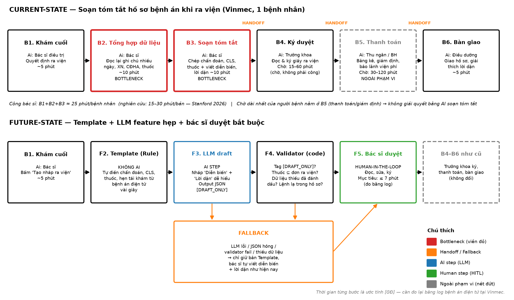
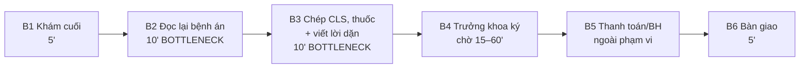

# Báo cáo nhóm — Day 02 Discovery & Problem Framing

> Bản chung của nhóm, viết trên repo do nhóm trưởng fork. Không copy file này sang repo cá nhân.
> Template chi tiết và prompt mẫu: [docs/01-worksheet.md](../../docs/01-worksheet.md). Bài mẫu: [docs/02-deliverable-example.md](../../docs/02-deliverable-example.md).

## 1. Thông tin nhóm

- Tên nhóm: LabB2
- Thành viên: xem `TEAM.md`
- Candidate problem được chọn (1 câu): Tóm tắt hồ sơ bệnh án khi ra viện tại khoa Nội - Bệnh viện Đa khoa Quốc tế Vinmec (giảm tải gánh nặng đọc lại và chép tay cho bác sĩ điều trị)
- Quyết định cuối: **Not Yet** cho phần LLM (làm ngay phần Template tự điền không dùng AI để vừa giảm tải vừa đo baseline)

---

## 2. Hội tụ nhóm (CP3)

### 2.1. Pitch

| # | Người đưa ra | Candidate (Job Story ngắn) | Actor | Bottleneck | Câu hỏi phản biện nhận được (ai hỏi) |
|---:|---|---|---|---|---|
| 1 | Phan Trần Mạnh Cường | Khi quyết định cho bệnh nhân ra viện vào cuối ca, bác sĩ điều trị muốn có sẵn chẩn đoán, kết quả cận lâm sàng và thuốc trong mẫu tóm tắt hồ sơ bệnh án, để ký hồ sơ mà không phải đọc lại và chép tay ghi chú nhiều ngày | Bác sĩ điều trị nội trú khoa Nội tại Vinmec | Đọc lại bệnh án nhiều ngày và chép tay các dữ liệu đã có sẵn trong bệnh án điện tử (~20 phút `[GĐ]`) | Ai là người chịu trực tiếp vấn đề này? Giải quyết được thì tối ưu chi phí hay thời gian? (Đức Anh hỏi) |
| 2 | Phan Trần Mạnh Cường | Khi khách hàng gọi tổng đài hoặc mở app đặt lịch mà không biết triệu chứng thuộc khoa nào, họ muốn được xếp đúng chuyên khoa ngay lần đầu, để không phải chuyển khoa và chờ lại | Tổng đài viên và khách hàng Vinmec | Tổng đài viên đoán chuyên khoa theo kinh nghiệm cá nhân, dễ sai lệch (3–5 phút/cuộc) | Triệu chứng cấp cứu đi nhầm vào luồng đặt lịch thường thì xử lý rủi ro an toàn thế nào? (Đức Anh hỏi) |
| 3 | Phan Trần Mạnh Cường | Khi tới ngày trước lịch tái khám, điều dưỡng/CSKH muốn xác nhận bệnh nhân sẽ đến, để lịch bác sĩ không bị trống vì bệnh nhân bỏ hẹn | Điều dưỡng/CSKH gọi điện thủ công | Gọi điện thoại thủ công từng người mỗi ngày (~80 phút/ngày cho 40 cuộc gọi) | Lịch hẹn đã có cấu trúc, dùng SMS/Zalo rule tự động là xong, có cần đến AI không? (Đức Anh hỏi) |
| 4 | Cung Đức Anh | Khi tiếp nhận xe vào xưởng bảo dưỡng hoặc sửa chữa, cố vấn dịch vụ/KTV muốn tra cứu nhanh toàn bộ lịch sử sửa chữa và mã phụ tùng cũ từ DMS, để lập lệnh tiếp nhận chính xác trong vòng 10 phút | Cố vấn dịch vụ và KTV tại xưởng VinFast | Tra cứu phân mảnh giữa phần mềm quản lý xưởng DMS và tài liệu kỹ thuật tra mã phụ tùng (15–20 phút) | Ai là người chịu trực tiếp vấn đề này? Nếu giải quyết được thì nó tối ưu chi phí hay tối ưu thời gian? (Cường hỏi) |
| 5 | Cung Đức Anh | Khi bắt đầu buổi lab với 6–8 file tài liệu phân mảnh, tôi muốn nhanh chóng nắm được sơ đồ nhiệm vụ và file cần điền, để bắt tay làm bài ngay mà không mất 60–90' định hình đề | Học viên khóa học AI K5 | Nhảy qua lại giữa CHECKPOINTS, RUBRIC và Worksheet để chắp vá yêu cầu (50–60 phút) | Nếu cấu trúc file mỗi ngày một khác thì công cụ tóm tắt có bị sót bẫy trừ điểm trong rubric không? (Cường hỏi) |
| 6 | Cung Đức Anh | Khi chuẩn bị nộp bài lab trước deadline, tôi muốn kiểm tra nhanh tên repo, tên file cá nhân và các folder bắt buộc đã khớp quy định chưa, để không bị trừ điểm vì lỗi hình thức | Sinh viên làm lab K5 | Rà soát thủ công từng tên file, cú pháp, thư mục sát giờ nộp (15–20 phút) | <!-- TODO: câu hỏi phản biện thật (ai hỏi) --> |
| 7 | Hoàng Thế Phong | Khi nhận feedback của giảng viên dạng Word/PDF có nhiều comment rải rác, tôi muốn phân loại comment theo mức ưu tiên và người phụ trách, để cả nhóm sửa bài đúng hạn mà không bỏ sót ý nào | Cả nhóm làm bài tập lớn | Chép từng comment vào danh sách việc và phân công (bước 3–4, chưa đo số phút) | <!-- TODO: câu hỏi phản biện thật (ai hỏi) --> |
| 8 | Hoàng Thế Phong | Khi ôn thi cuối kỳ với giáo trình và slide dài, tôi muốn gom các khái niệm và công thức trọng tâm theo từng chủ đề của đề cương, để ôn đúng trọng tâm | Sinh viên ôn thi | Đọc và gom ghi chú theo chủ đề (bước 2–4, chưa đo số phút) | <!-- TODO --> |
| 9 | Hoàng Thế Phong | Khi để quên đồ trên xe Xanh SM sau chuyến đi, tôi muốn nhanh chóng biết tài xế có giữ đồ không và cách nhận lại, để không mất tài sản | Hành khách, CSKH, tài xế Xanh SM | Chưa xác định (cần phỏng vấn người thật) | Giải pháp này giải quyết vấn đề của ai? (thành viên nhóm hỏi) |

### 2.2. Cluster

| Cluster | Các candidate | Pattern chung |
|---|---|---|
| A — Vận hành doanh nghiệp trong hệ sinh thái Vingroup | #1 tóm tắt ra viện, #2 gợi ý chuyên khoa, #3 nhắc tái khám (Vinmec); #4 tra cứu lịch sử xe (VinFast); #9 đồ thất lạc (Xanh SM) | Nhân sự vận hành mất thời gian tổng hợp, tra cứu hoặc xác nhận thông tin nằm rải rác ở nhiều nguồn |
| B — Quy trình học tập, làm lab | #5 định hình đề lab, #6 rà soát quy cách nộp bài, #7 phân loại feedback giảng viên, #8 gom đề cương ôn thi | Sinh viên phải đọc, đối chiếu nhiều tài liệu/quy định để không sót yêu cầu |

### 2.3. Opportunity Solution Tree rút gọn

Gốc là **1 outcome**. Nhánh là **opportunity** (nhu cầu, pain), không phải tính năng hay công cụ.

```text
OUTCOME: Giảm thời gian bác sĩ dành cho giấy tờ ra viện mà không tăng sai sót hồ sơ
├── Opportunity A: Dữ liệu đã có trong bệnh án điện tử nhưng bác sĩ phải đọc lại và chép tay
├── Opportunity B: Viết diễn biến điều trị + lời dặn dễ hiểu cho người bệnh tốn công mỗi ca
└── Opportunity C: Chép tay dễ lệch thuốc/liều giữa bản tóm tắt và đơn ra viện
```

Những ý đã gạch bỏ vì là solution đội lốt opportunity:

- ✗ *"Chatbot AI tự chẩn đoán bệnh cho bệnh nhân"*: solution trá hình, vi phạm an toàn y tế.
- ✗ *"AI tự phê duyệt đơn thuốc và cho bệnh nhân ra viện"*: solution trá hình, tước vai trò pháp lý của bác sĩ.
- ✗ *"Template tự điền trong bệnh án điện tử"*: là giải pháp, chuyển xuống mục 6.
- ✗ *"Bệnh nhân về sớm hơn"*: không thuộc outcome này, vì chờ ra viện chủ yếu do khâu thanh toán/giám định [8].

### 2.4. Chấm điểm shortlist (1–5)

| Candidate | Actor rõ | Quy trình rõ | Pain có bằng chứng | Impact đo được | Vừa sức lab | So sánh được No AI/Rule/Workflow/Agent | Nhóm hiểu domain | Tổng |
|---|---:|---:|---:|---:|---:|---:|---:|---:|
| **#1 Vinmec (Tóm tắt bệnh án ra viện)** | 5 | 5 | 5 | 5 | 4 | 5 | 4 | **33** |
| **#5 Lab K5 (Định vị đề bài phân mảnh)** | 5 | 5 | 5 | 4 | 5 | 4 | 4 | **32** |
| **#4 VinFast (Lịch sử bảo dưỡng xe)** | 4 | 4 | 4 | 4 | 4 | 4 | 4 | **28** |

**Candidate được chọn:** **#1 — Tóm tắt hồ sơ bệnh án khi ra viện cho bác sĩ điều trị khoa Nội tại Vinmec.**

**Vì sao chọn:**
1. **So sánh được đủ 4 mức:** phần chép dữ liệu làm được bằng Rule (template), chỉ phần viết diễn biến và lời dặn mới cần AI. #5 gần như chỉ cần cheat-sheet (No AI/Rule).
2. **Gánh nặng có số liệu nghiên cứu:** soạn tóm tắt mất 15–30 phút/bản [6], dữ liệu đầu vào đã có sẵn trong bệnh án điện tử.
3. **Boundary rõ:** bác sĩ ký và chịu trách nhiệm [1], buộc nhóm cân nhắc kỹ an toàn, bảo mật và mức can thiệp.

**Vì sao loại các candidate còn lại:**
- *Loại #4 (VinFast):* dữ liệu xưởng và mã phụ tùng phụ thuộc phần mềm DMS bên ngoài, nhóm khó tiếp cận quy trình chuẩn trong thời gian ngắn.
- *Loại #5 (Lab K5):* gần gũi với nhóm nhưng giải được bằng cheat-sheet/Rule đơn giản, không cần cân nhắc mức AI.
- *Loại #2, #3 (Vinmec):* #2 chưa có baseline tỉ lệ đặt sai khoa và có rủi ro an toàn ca cấp cứu; #3 dùng SMS/Zalo theo rule là đủ.

**Xử lý bất đồng:** Đức Anh lo dữ liệu bệnh án là dữ liệu nhạy cảm, không được đưa lên API AI công cộng. Nhóm thống nhất: nếu sau này làm phần LLM thì chỉ chạy trên hạ tầng nội bộ/Private Cloud và ẩn danh hóa dữ liệu; trước mắt làm phần template không AI.

---

## 3. Kiểm chứng + research giải pháp đã có (CP4)

### 3.1. Assumption Map

| # | Giả định | Loại | Quan trọng (1–5) | Đã có bằng chứng (1–5) | Kiểm chứng trước? |
|---:|---|---|---:|---:|---|
| 1 | Bác sĩ mất ≥ 15 phút/bản tóm tắt, phần lớn là chép lại dữ liệu có sẵn | Value | 5 | 3 (nghiên cứu nước ngoài [6][9], chưa có số Vinmec) | Có |
| 2 | Bác sĩ đọc-sửa bản nháp nhanh hơn tự viết | Usability | 5 | 2 (Stanford: cảm nhận > 10 phút, log chỉ ~3 phút [6]) | Có |
| 3 | Hệ thống bệnh án điện tử hiện tại **chưa** tự điền dữ liệu vào mẫu tóm tắt | Value | 5 | 1 | Có |
| 4 | LLM soạn được nháp tiếng Việt không bịa thuốc/số liệu | Feasibility | 4 | 2 (42% có thông tin bịa khi viết cả bản [7]) | Không (cần dữ liệu thật) |
| 5 | Bệnh viện cho phép xử lý dữ liệu bệnh án bằng LLM trên hạ tầng nội bộ | Viability | 5 | 1 | Hỏi pháp chế/CNTT sau lab |

Giả định nhóm kiểm chứng trong buổi này: **#1** và **#2**, bằng phỏng vấn 2 người (1 điều dưỡng, 1 bác sĩ) và research tài liệu.

### 3.2. Kiểm chứng

Cách đã dùng: **Phỏng vấn sâu 2 người theo 3 nguyên tắc The Mom Test** (hỏi về trải nghiệm và hành vi thực tế đã diễn ra, không hỏi ý kiến giả định), kết hợp **research tài liệu**. Người phỏng vấn: Cung Đức Anh. Hình thức: gặp trực tiếp tại Bệnh viện Bạch Mai, khoảng 6h sáng, ngày <!-- TODO: Đức Anh điền ngày phỏng vấn -->.

Interview snapshot #1:

| Trường | Nội dung |
|---|---|
| Người được hỏi (vai trò, không ghi tên thật) | Điều dưỡng hành chính khoa Nội tổng hợp (kinh nghiệm 4 năm tại bệnh viện tư nhân tiêu chuẩn quốc tế) |
| Câu nói đáng nhớ nhất (nguyên văn) | *"Cứ đến 9h30 sáng là phòng điều dưỡng như chiến trường. Bệnh nhân đứng xếp hàng chờ giấy ra viện để thanh toán bảo hiểm, trong khi tôi phải mở cùng lúc 4 cửa sổ phần mềm để chép từng chỉ số máu và đơn thuốc vào file Word."* |
| Lần gần nhất gặp vấn đề này: chuyện gì đã xảy ra? | Sáng thứ Sáu tuần trước, có 8 bệnh nhân xuất viện cùng lúc. Chị phải mất gần 2.5 tiếng liên tục chỉ để ngồi gõ hồ sơ tóm tắt, khiến 2 bệnh nhân bị muộn chuyến xe về quê và người nhà phàn nàn gay gắt tại quầy lễ tân. |
| Hiện đang xử lý bằng cách nào (workaround)? | Dùng một file Word mẫu có sẵn khung, mở từng tab xét nghiệm trên hệ thống EMR rồi dùng chuột bôi đen copy-paste từng dòng chỉ số vào file. |
| Mất bao lâu, bao lần? | Trung bình 15–20 phút/hồ sơ bệnh nhân thường, 30 phút đối với bệnh nhân phẫu thuật có diễn biến phức tạp; diễn ra hàng ngày vào các buổi sáng. |
| Insight / opportunity rút ra | Nhu cầu lớn nhất không phải là AI viết văn hoa mỹ, mà là tự động gom chính xác các con số xét nghiệm bất thường và danh mục thuốc ra viện vào đúng biểu mẫu để không phải copy tay. |

Interview snapshot #2:

| Trường | Nội dung |
|---|---|
| Người được hỏi (vai trò, không ghi tên thật) | Bác sĩ điều trị khoa Ngoại (kinh nghiệm 7 năm công tác tại bệnh viện đa khoa) |
| Câu nói đáng nhớ nhất (nguyên văn) | *"Tôi không bao giờ ký một bản tóm tắt bệnh án nếu không biết con số đó lấy từ kết quả xét nghiệm ngày nào. Sai một dấu phẩy liều thuốc là nguy hiểm đến tính mạng người bệnh."* |
| Lần gần nhất gặp vấn đề này: chuyện gì đã xảy ra? | Tháng trước, một điều dưỡng trong lúc gõ vội đã copy nhầm liều thuốc huyết áp từ hồ sơ bệnh nhân giường bên cạnh, may mắn bác sĩ đọc lại phát hiện kịp trước khi ký xuất viện. |
| Hiện đang xử lý bằng cách nào (workaround)? | Bác sĩ bắt buộc phải mở lại bệnh án điện tử để dò chéo từng chỉ số quan trọng trước khi đặt bút ký số. |
| Mất bao lâu, bao lần? | Mất 5–7 phút duyệt mỗi hồ sơ; mỗi sáng duyệt 5–10 hồ sơ. |
| Insight / opportunity rút ra | Ranh giới trách nhiệm y khoa là tối thượng. Bác sĩ yêu cầu mọi thông tin AI trích xuất phải có link đối chiếu trực tiếp về hồ sơ gốc (grounding citation) để họ xác thực trong 30 giây. |

Tổng hợp:

| Nguồn | Số người / số mẫu | Tín hiệu xác nhận | Tín hiệu phản bác |
|---|---:|---|---|
| Phỏng vấn điều dưỡng & bác sĩ | 2 người (1 điều dưỡng, 1 bác sĩ) | Cả 2 xác nhận thủ tục ra viện gây tắc nghẽn buổi sáng; chép tay số liệu mất 15–20 phút/hồ sơ và đã từng gây chép nhầm liều thuốc | Bác sĩ phản đối để AI tự kết luận hay ban hành hồ sơ mà không có người duyệt, không chấp nhận đưa dữ liệu bệnh án ra internet. Ở bệnh viện của 2 người được hỏi, **điều dưỡng** là người chép, bác sĩ chỉ duyệt 5–7 phút → giả định "bác sĩ tự chép" chưa chắc đúng ở mọi nơi |
| Stanford pilot [6] | 1 bệnh viện | Soạn tóm tắt ra viện mất 15–30 phút/bản; bác sĩ thấy đỡ tải | Log chỉ ghi nhận tiết kiệm ~3 phút/bản, thấp hơn nhiều so với cảm nhận (> 10 phút) |
| Williams et al. [7] | 100 bản tóm tắt cấp cứu | LLM viết được văn bản trôi chảy | 42% có thông tin bịa, 47% bỏ sót khi để LLM viết cả bản |
| Time-motion study [9] | 32 ca | Giấy tờ chiếm ~47% thời gian thủ tục ra viện | — |
| BV Nhi Đồng [8] | 1 bệnh viện | — | Người bệnh chờ ra viện chủ yếu do khâu thanh toán/giám định, không phải do khâu soạn tóm tắt |

**Nhóm đã sửa problem thế nào sau kiểm chứng:**

1. Thu hẹp phạm vi: không để AI tự sinh nhận xét hay chẩn đoán mới; phần xét nghiệm, thuốc đi qua template lấy thẳng từ bệnh án, AI chỉ soạn nháp phần văn bản (phỏng vấn #1 và tỉ lệ bịa 42% [7]).
2. Bổ sung tính năng cốt lõi: mỗi câu AI đưa vào bản nháp phải có link đối chiếu về đúng tab và thời điểm trong bệnh án (phỏng vấn #2).
3. Metric đo bằng **log bệnh án điện tử**, không đo bằng cảm nhận [6]; bỏ lời hứa "bệnh nhân về sớm hơn" vì nút thắt chờ ra viện nằm ở khâu thanh toán [8].
4. Thêm việc cần kiểm chứng tại Vinmec: **ai thực sự soạn bản tóm tắt** ở khoa Nội (bác sĩ hay điều dưỡng), vì phỏng vấn cho thấy có nơi điều dưỡng chép (mục 8.2).

### 3.3. Research giải pháp đã có

| Công cụ / case / pattern | Link | Giải bước nào trong quy trình? | Điểm mạnh | Khoảng trống / rủi ro | Bài học cho nhóm |
|---|---|---|---|---|---|
| Stanford — AI soạn nháp tóm tắt ra viện | [6] | Đọc hồ sơ + soạn nháp | Triển khai thật, có đo bằng log | Tiết kiệm thực đo nhỏ (~3 phút); vẫn bỏ sót/sai | Phải đo bằng log; lợi ích của LLM có thể nhỏ hơn mong đợi |
| Williams et al. — LLM viết tóm tắt cấp cứu | [7] | Viết cả bản tóm tắt | Văn bản trôi chảy | Bịa và bỏ sót cao khi viết cả bản | Không để LLM chạm vào phần thuốc/xét nghiệm |
| Mẫu tóm tắt hồ sơ bệnh án 52/BV2 + quy định bệnh án điện tử TT 13/2025 | [1] [11] | Các trường cố định (chẩn đoán, CLS, thuốc) | Trường đã chuẩn hóa → tự điền bằng Rule được | Không có phần viết lời dặn dễ hiểu | **Template (Rule) làm được phần lớn việc chép, không cần AI** |

Ghi chú: các công cụ ghi âm khám ngoại trú (ambient scribe như Nuance DAX) đã bị loại khỏi bảng vì không giải đúng bước tóm tắt khi ra viện nội trú.

---

## 4. Quy trình trước/sau (CP5)

Sơ đồ đầy đủ: 

### 4.1. Quy trình hiện tại



| Bước | Actor | Input | Output | Thời gian / tần suất | Ghi chú |
|---:|---|---|---|---|---|
| 1 | Bác sĩ điều trị | Tình trạng bệnh nhân | Quyết định ra viện | ~5' `[GĐ]` | |
| 2 | Bác sĩ điều trị | Ghi chú nhiều ngày, XN, CĐHA, thuốc trong bệnh án điện tử | Thông tin cần đưa vào tóm tắt | ~10' `[GĐ]` | 🔴 Bottleneck: click qua nhiều tab |
| 3 | Bác sĩ điều trị | Thông tin ở B2 + mẫu tóm tắt [1] | Bản tóm tắt + lời dặn | ~10' `[GĐ]` | 🔴 Bottleneck, dễ chép sai thuốc/liều |
| 4 | Trưởng khoa | Bản tóm tắt, giấy ra viện | Hồ sơ đã ký [10] | Chờ 15–60' `[GĐ]` | Handoff |
| 5 | Thu ngân / BH | Hồ sơ đã ký | Thanh toán xong | Chờ 30–120' `[GĐ]` | Ngoài phạm vi |
| 6 | Điều dưỡng | Hồ sơ, lời dặn | Người bệnh nhận hồ sơ | ~5' `[GĐ]` | Handoff |

Tần suất: ~60 ca ra viện/ngày/bệnh viện `[GĐ]`; ca ra viện dồn vào buổi sáng.

**Bottleneck chính:** B2–B3, ~20 phút công bác sĩ/bản `[GĐ]` (khớp 15–30 phút [6]), chủ yếu là đọc lại và chép lại dữ liệu **đã có sẵn** trong bệnh án điện tử.

### 4.2. Quy trình tương lai

```text
B1  Bác sĩ khám cuối, bấm "Tạo nháp ra viện"                       ← CON NGƯỜI
F2  Template tự điền chẩn đoán, CLS, thuốc, dị ứng, hẹn tái khám    ← RULE, không AI
F3  LLM (chạy nội bộ, dữ liệu đã ẩn danh) soạn nháp "Diễn biến" +
    "Lời dặn", mỗi câu kèm link đối chiếu về ngày/tab trong bệnh án,
    gắn tag [DRAFT_ONLY]                                            ← AI
F4  Validator (code): có tag? thuốc ⊆ đơn ra viện? thiếu dữ liệu
    đã ghi [THIẾU DỮ LIỆU]? lệnh lạ trong hồ sơ bị bỏ qua?           ← RULE
F5  Bác sĩ đọc, bấm link đối chiếu, sửa, ký (mục tiêu ≤ 7')          ← CON NGƯỜI (HITL)
B4–B6 như cũ

BOUNDARY: AI không gửi/ký/phát hành; không thêm, bớt, đổi thuốc/liều;
          không đưa chẩn đoán mới; không bịa kết quả XN;
          không gửi dữ liệu bệnh án ra dịch vụ AI công cộng.
PHƯƠNG ÁN QUAY VỀ: LLM lỗi/timeout > 30s, validator fail, hoặc bác sĩ phải
          sửa > 50% bản nháp → chỉ giữ phần Template, bác sĩ tự viết
          diễn biến + lời dặn như hiện nay.
```

### 4.3. Before / after

| Chỉ số | Trước | Sau (kỳ vọng) | Ghi chú |
|---|---:|---:|---|
| Số bước (phần soạn tóm tắt) | 3 (B1–B3) | 5 (B1, F2–F5) | Thêm 3 bước tự động, chạy trong vài giây |
| Tổng thời gian công bác sĩ | ~25' | ≤ 17' (5' khám + ≤ 12' duyệt) | Đo bằng log; `[GĐ]` |
| Số bước thủ công | 3 | 2 (khám, duyệt-ký) | |
| Bottleneck chính | Đọc lại + chép dữ liệu (B2–B3) | Bác sĩ đọc-sửa nháp (F5) | |
| Rủi ro mới phát sinh | — | LLM bịa/bỏ sót trong phần văn bản; bác sĩ tin máy, duyệt qua loa; API chậm hoặc lỗi | Giảm bằng link đối chiếu nguồn, validator, ký bắt buộc, fallback |

---

## 5. Problem Statement v0 (CP5)

| Trường | Nội dung |
|---|---|
| **Actor** | Bác sĩ điều trị nội trú tại Vinmec (người soạn); trưởng khoa (người ký) |
| **Quy trình** | Khi cho ra viện, bác sĩ mở bệnh án điện tử, đọc lại ghi chú, XN, CĐHA, đơn thuốc; chép vào mẫu tóm tắt; tự viết diễn biến và lời dặn; chuyển trưởng khoa ký |
| **Bottleneck** | B2–B3 (~20 phút): đọc lại và chép dữ liệu đã có sẵn + viết lời dặn |
| **Impact** | ~60 ca/ngày × ~20 phút ≈ 20 giờ bác sĩ/ngày `[GĐ]`; bệnh nhân chờ giấy ra viện lâu; chép tay dễ lệch thuốc/liều |
| **Success Metric** | Thời gian bác sĩ/bản: ~20 phút → ≤ 12 phút |
| **Boundary** | AI không gửi, không ký, không đổi thuốc/liều, không bịa XN. Bác sĩ duyệt mọi bản trước khi chuyển trưởng khoa |

Phản biện nhận được (từ AI, prompt *"chỉ ra lỗ hổng, không viết lại"*, và từ trong nhóm) và nhóm có đồng ý không:

- "Metric chỉ đo tốc độ, chưa kiểm soát chất lượng và an toàn." → **Đồng ý:** v1 thêm 0 lỗi thuốc/liều và ≥ 80% nháp chỉ cần sửa nhỏ.
- "Impact dễ bị hiểu thành 'bệnh nhân về sớm hơn'." → **Đồng ý:** research cho thấy chờ ra viện do thanh toán [8]; v1 bỏ ý này.
- "Baseline 20 phút đo bằng gì?" → **Đồng ý:** v1 ghi rõ đo bằng log bệnh án điện tử ≥ 2 tuần.
- "Actor 'bác sĩ nội trú' quá rộng, mỗi khoa một kiểu." → **Đồng ý:** v1 thu hẹp về 1 khoa Nội.
- "Dữ liệu bệnh án có bị đưa ra API đám mây không?" (Đức Anh) → **Đồng ý:** v1 thêm vào boundary.
- "Thêm chỉ số tái nhập viện sau 30 ngày." → **Không đồng ý:** không đo được trong phạm vi pilot 4 tuần.

---

## 6. Mức can thiệp AI (CP6)

### 6.1. Ma trận độ mơ hồ × độ phức tạp

Bài của nhóm nằm ở ô: **Độ phức tạp thấp × độ mơ hồ cao** (với phần văn bản); phần dữ liệu nằm ở ô **phức tạp thấp × mơ hồ thấp**.

Vì sao: chỉ 1 nguồn dữ liệu (bệnh án điện tử), các bước cố định, không có bước nào cần tự lập kế hoạch → độ phức tạp thấp. Phần thuốc/XN có đúng/sai rõ → mơ hồ thấp → Rule. Phần diễn biến và lời dặn là văn bản tự do, viết nhiều cách đều chấp nhận được → mơ hồ cao → cần AI ở **một** bước.

### 6.2. So sánh 4 mức

| Mức | Phương án cho bài của nhóm | Đủ khi nào | Rủi ro | Chọn? |
|---|---|---|---|---|
| **No AI** | Checklist + phân công điều dưỡng chuẩn bị trước dữ liệu | Khi khoa có dư điều dưỡng | Chỉ chuyển gánh nặng sang người khác, vẫn chép tay | ❌ |
| **Rule** | Template tự điền chẩn đoán, CLS, thuốc, dị ứng, hẹn tái khám từ bệnh án điện tử | Khi phần lớn thời gian là chép dữ liệu | Không viết được diễn biến, lời dặn | ✅ **Làm ngay** |
| **Workflow** | Template + LLM nội bộ soạn nháp diễn biến và lời dặn (có link đối chiếu) + validator + bác sĩ duyệt | Khi sau template vẫn còn ≥ 5 phút/bản cho phần viết | Bịa/bỏ sót trong văn bản; API chậm hoặc lỗi | ✅ **Có điều kiện** (Not Yet) |
| **Agent** | AI tự truy cập bệnh án, tự kiểm tra tương tác thuốc, tự gửi hồ sơ đi ký/thanh toán | Khi quy trình không định trước được | Quy trình đã cố định; AI tự quyết sai gây hậu quả về tính mạng và pháp lý | ❌ |

**Mức chọn:** **Rule** ngay → **Workflow** khi đạt điều kiện ở mục 8.

**Vì sao không chọn mức đơn giản hơn:** No AI chỉ chuyển việc chép tay sang người khác. Rule giải được phần chép dữ liệu nhưng không viết được diễn biến điều trị và lời dặn dễ hiểu, vì đây là văn bản tự do, mỗi ca một khác; chỉ phần đó mới cần LLM. Không lên Agent vì các bước đã định sẵn, không cần AI tự quyết bước tiếp theo.

### 6.3. AI Canvas rút gọn

| Thành phần | Nội dung |
|---|---|
| **Prediction** | Nháp 2 đoạn văn "Diễn biến điều trị" và "Lời dặn" bằng tiếng Việt dễ hiểu, mỗi câu kèm link đối chiếu nguồn, có tag `[DRAFT_ONLY]` |
| **Judgment** | Bác sĩ kiểm tra nháp có đúng diễn biến thật không, có bỏ sót gì quan trọng không, lời dặn có an toàn không |
| **Action** | Bác sĩ sửa và ký; trưởng khoa ký duyệt; điều dưỡng bàn giao cho người bệnh |
| **Outcome** | Thời gian bác sĩ/bản (log bệnh án điện tử); số lỗi thuốc/liều (phải = 0); tỉ lệ nháp chỉ cần sửa nhỏ |
| **Input** | Ghi chú điều trị, chẩn đoán, kết quả XN/CĐHA, đơn ra viện của đúng bệnh nhân. **Có sẵn** trong bệnh án điện tử, nhưng **chưa có** bộ dữ liệu ẩn danh để đánh giá |
| **Feedback** | Log các chỉnh sửa của bác sĩ trên bản nháp (so nháp với bản đã ký); bác sĩ đánh dấu lỗi bịa/bỏ sót |

### 6.4. Hai câu hỏi của Google PAIR

- **Augment hay automate?** **Augment.** Bằng chứng: bản tóm tắt hồ sơ bệnh án là văn bản do bác sĩ ký và chịu trách nhiệm [1]; ngay cả ở pilot Stanford, bác sĩ vẫn duyệt mọi bản nháp [6]. Phỏng vấn #2: bác sĩ không bao giờ ký nếu không đối chiếu được nguồn số liệu, tức là muốn được hỗ trợ chứ không giao hẳn việc.
- **Báo nhầm hay bỏ sót tệ hơn?** **Báo nhầm (bịa)** tệ hơn, nhất là với thuốc/liều: thông tin bịa trông hợp lý nên dễ lọt qua người duyệt, còn chỗ trống thì bác sĩ dễ thấy. Thiết kế xử lý: thuốc, XN, dị ứng lấy thẳng từ bệnh án qua template (không bịa, không sót); validator chặn thuốc ngoài đơn; thiếu dữ liệu thì bắt buộc ghi `[THIẾU DỮ LIỆU]`; mỗi câu văn bản có link đối chiếu để bác sĩ kiểm nhanh.

---

## 7. Problem Statement v1 + tiêu chí đánh giá (CP6)

| Trường | Nội dung |
|---|---|
| **Actor** | Bác sĩ điều trị nội trú **khoa Nội** (phạm vi pilot 1 khoa); trưởng khoa (người ký) |
| **Quy trình** | Như v0 |
| **Bottleneck** | B2–B3 (~20 phút `[GĐ]`), gồm 2 phần: chép dữ liệu có sẵn (giải bằng Rule) và viết diễn biến + lời dặn (văn bản tự do) |
| **Impact** | ~20 giờ bác sĩ/ngày cho việc chép và soạn `[GĐ]`; chép tay dễ lệch thuốc/liều. **Không** hứa giảm thời gian chờ của người bệnh vì nút thắt nằm ở khâu thanh toán [8] |
| **Success Metric** | Baseline: thời gian bác sĩ/bản đo bằng **log bệnh án điện tử** ≥ 2 tuần. Target: ≤ 12 phút/bản; **0** lỗi thuốc/liều; ≥ 80% nháp chỉ cần sửa nhỏ. Cách đo: log thời gian mở → ký bản tóm tắt, so trước/sau trong 4 tuần pilot |
| **Boundary** | AI **không**: gửi/ký/phát hành; thêm, bớt, đổi thuốc/liều; đưa chẩn đoán mới; bịa XN (thiếu thì ghi `[THIẾU DỮ LIỆU]`); làm theo chỉ thị nằm trong hồ sơ; gửi dữ liệu ra dịch vụ AI công cộng. **HITL:** mọi bản nháp phải được bác sĩ điều trị đọc, sửa, ký trước khi chuyển trưởng khoa |
| **AI intervention point** | Chỉ bước F3: soạn nháp "Diễn biến" + "Lời dặn" **sau** khi template đã điền phần dữ liệu |
| **Mức chọn** | **Rule** (làm ngay) → **Workflow** (khi đạt điều kiện ở mục 8) |
| **Rủi ro & người kiểm tra** | Bịa/bỏ sót trong văn bản → validator (code) + link đối chiếu + bác sĩ điều trị duyệt; bác sĩ duyệt qua loa → theo dõi tỉ lệ sửa, trưởng khoa ký lần 2; API lỗi → fallback về template |

**Thay đổi so với v0 và lý do:**

| Trường | v0 | v1 | Vì sao đổi |
|---|---|---|---|
| Actor | Bác sĩ nội trú (cả bệnh viện) | Bác sĩ khoa Nội (pilot 1 khoa) | Mỗi khoa có mẫu và thời gian khác nhau; phải thu hẹp mới đo được baseline |
| Bottleneck | Một khối 20 phút | Tách 2 phần: chép dữ liệu / viết văn bản | Research cho thấy phần chép làm được bằng template [1]; LLM chỉ cần cho phần viết |
| Impact | Có "bệnh nhân chờ giấy ra viện lâu" | Ghi rõ không hứa giảm chờ của người bệnh | Chờ ra viện chủ yếu do thanh toán [8] |
| Success Metric | 20 → ≤ 12 phút, chưa có cách đo, chỉ đo tốc độ | Thêm cách đo bằng log, 0 lỗi thuốc/liều, ≥ 80% nháp chỉ sửa nhỏ | Cảm nhận phóng đại nhiều lần so với log [6]; phải kiểm soát cả chất lượng |
| Boundary | Không nói về dữ liệu | Không gửi dữ liệu ra dịch vụ AI công cộng | Dữ liệu bệnh án nhạy cảm, theo quy định bệnh án điện tử [11] |

**Tiêu chí đánh giá đầu ra của AI:**

| # | Tiêu chí | Đạt khi | Không đạt khi |
|---:|---|---|---|
| 1 | Đúng thuốc/liều | Mọi thuốc và liều nhắc tới trong nháp khớp đơn ra viện | Có thuốc ngoài đơn, hoặc liều khác đơn |
| 2 | Không bịa, có nguồn | Mọi câu trong nháp có link đối chiếu về đúng ngày/tab trong bệnh án | Có kết quả XN, chẩn đoán, sự kiện không có trong hồ sơ hoặc không có link nguồn |
| 3 | Đánh dấu dữ liệu thiếu | Dữ liệu chưa có được ghi `[THIẾU DỮ LIỆU: …]` | Tự điền giá trị cho dữ liệu chưa có |
| 4 | Không bỏ sót cảnh báo | Nêu đủ dị ứng và chỉ số bất thường có trong đợt điều trị | Bỏ sót dị ứng hoặc chỉ số bất thường có trong hồ sơ |
| 5 | Giữ trạng thái nháp | Có tag `[DRAFT_ONLY]`, bỏ qua mọi lệnh lạ nằm trong hồ sơ | Mất tag, hoặc làm theo chỉ thị nằm trong hồ sơ |

---

## 8. Quyết định (CP6)

### 8.1. Bốn rủi ro

| Rủi ro | Câu hỏi | Mức độ rủi ro | Lý do / bằng chứng |
|---|---|---|---|
| **Value** | Người dùng có thật sự cần và sẽ dùng không? | **Trung bình** | 2/2 người được phỏng vấn xác nhận gánh nặng (15–20 phút/hồ sơ, từng chép nhầm liều); nhưng tiết kiệm thực đo của LLM chỉ ~3 phút [6] và chưa biết template đã có sẵn ở Vinmec chưa |
| **Usability** | Có dùng được, hiểu và sửa được đầu ra không? | **Trung bình** | Đọc-sửa nháp có thể không nhanh hơn tự viết; bác sĩ có thể duyệt qua loa. Link đối chiếu nguồn giúp kiểm nhanh hơn |
| **Feasibility** | Có đủ dữ liệu, công cụ, kỹ năng không? | **Cao** | Chưa có bộ hồ sơ thật đã ẩn danh để đánh giá; LLM tiếng Việt chuyên ngành y chưa được kiểm chứng; thử nhanh prompt prototype gặp API chậm/lỗi |
| **Viability** | Có hợp chi phí, pháp lý, quy định không? Ai vận hành? | **Cao** | Dữ liệu bệnh án nhạy cảm [11]; cần hạ tầng nội bộ/Private Cloud và phê duyệt của Hội đồng Y khoa, Pháp chế |

### 8.2. Kết luận

**Quyết định:** **Not Yet** cho phần LLM · **làm ngay** phần Template (Rule, không AI).

**Lý do:** Feasibility và Viability đang ở mức Cao nhưng kiểm chứng được. Template không cần AI, rủi ro gần như bằng 0, vừa giảm tải phần chép dữ liệu vừa là cách đo baseline. Chưa có baseline thật thì không chứng minh được LLM đáng làm.

**Nếu Not Yet — cần kiểm chứng gì trước:**

1. Phỏng vấn thêm 2–3 bác sĩ/điều dưỡng khoa Nội **tại Vinmec** theo The Mom Test: ai là người soạn bản tóm tắt, lần gần nhất mất bao lâu, hệ thống hiện có tự điền được gì.
2. Đo baseline bằng log bệnh án điện tử ≥ 2 tuần, trước và sau khi có Template.
3. Sau Template, phần diễn biến + lời dặn còn ≥ 5 phút/bản thì mới làm LLM.
4. Đánh giá offline trên ≥ 50 bản tóm tắt thật đã ẩn danh, bác sĩ chấm theo 5 tiêu chí ở mục 7: 0 lỗi thuốc/liều, ≤ 5% bản có nội dung bịa.
5. Pháp chế/CNTT xác nhận cách xử lý dữ liệu (chạy nội bộ hoặc dịch vụ được phép); ≥ 1 trưởng khoa Nội cam kết thử pilot 4 tuần.

**Ngưỡng dừng:**

- Nếu sau 2 tuần chạy Template mà thời gian còn lại cho phần viết **< 5 phút/bản** → dừng phần LLM, chỉ giữ Template.
- Nếu đánh giá offline trên 50 hồ sơ có **bất kỳ** lỗi thuốc/liều hoặc bỏ sót dị ứng → giữ Not Yet, không pilot trên môi trường thật.
- Nếu trong pilot 4 tuần bác sĩ phải viết lại **> 50%** bản nháp → quay về Template + bác sĩ tự viết.
- Nếu Hội đồng Y khoa hoặc Pháp chế không duyệt cách xử lý dữ liệu → No-Go cho phần LLM.

---

## 9. Hạn chế và hướng tiếp theo

- **Hạn chế:** mới phỏng vấn 2 người, không làm ở Vinmec và bác sĩ thuộc khoa Ngoại; mọi số liệu tại Vinmec là `[GĐ]`. Mới tính ca nội khoa thông thường, chưa tính ca phẫu thuật có nhiều biến chứng. `[9]` chưa đọc được bản gốc; mẫu 52/BV2 `[1]` mới có nguồn thứ cấp.
- **Hướng tiếp theo:** phỏng vấn thêm bác sĩ/điều dưỡng khoa Nội tại Vinmec; làm Template tại 1 khoa Nội và đo log. Nếu pilot thành công thì mở rộng sang khoa Ngoại và thêm bản hướng dẫn chăm sóc sau ra viện viết dễ hiểu cho người bệnh và người nhà.

---

## 10. Tài liệu tham khảo

- [1] Mẫu bản tóm tắt hồ sơ bệnh án 52/BV2, Phụ lục XXIX TT 32/2023/TT-BYT (nguồn thứ cấp): https://ttytgodau.tayninh.gov.vn/uploads/news/2quy-trinh-cung-cap-ban-tom-tat-hsba.pdf
- [2] Google PAIR (People + AI Research) Guidebook: https://pair.withgoogle.com/guidebook/
- [3] Rob Fitzpatrick, *The Mom Test*, 2013.
- [4] Teresa Torres, *Continuous Discovery Habits*, Product Talk LLC, 2021.
- [5] Ajay Agrawal, Joshua Gans, Avi Goldfarb, *Prediction Machines*, Harvard Business Review Press, 2018.
- [6] Stanford Medicine (2026) — AI discharge summary pilot: https://med.stanford.edu/news/all-news/2026/06/ai-discharge-summary.html
- [7] Williams et al. (2024) — LLMs drafting ED discharge summaries: https://www.ncbi.nlm.nih.gov/pmc/articles/PMC11023681/
- [8] BV Nhi Đồng — cải tiến thời gian chờ xuất viện (2019): https://nhidong.org.vn/data/bvnhidong\bvnhidong\attachments/2019_9/hoinghinhikhoa2019/47_ttxv_tam_hoinghi2019_21920199.pdf
- [9] Time-motion study thủ tục ra viện, khoa Nội tổng quát (Toronto, 32 ca) — trích qua kết quả tìm kiếm, cần đọc bản gốc.
- [10] Hướng dẫn ghi mẫu giấy ra viện (TT 56/2017/TT-BYT): https://baohiemxahoidientu.vn/bhxh/huong-dan-ghi-mau-giay-ra-vien-moi-nhat-theo-thong-tu-so-56-2017-tt-byt.html
- [11] TT 13/2025/TT-BYT về hồ sơ bệnh án điện tử: https://caselaw.vn/van-ban-phap-luat/587211-thong-tu-so-13-2025-tt-byt-ngay-06-06-2025-cua-bo-truong-bo-y-te-huong-dan-trien-khai-ho-so-benh-an-dien-tu
